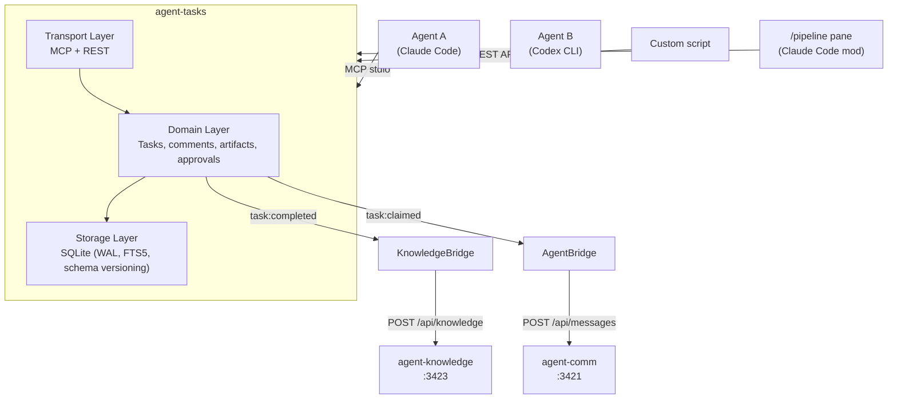

# Architecture

## Source structure

```
src/
├── types.ts              # Shared types, error hierarchy (TasksError -> NotFound/Conflict/Validation)
├── context.ts            # DI root — creates and wires all services, no global state
├── package-meta.ts       # Reads name/version from package.json (MCP initialize, REST /health)
├── lib.ts                # Library exports (agent-tasks/lib)
├── index.ts              # MCP entry point (stdio JSON-RPC) + REST server auto-start
├── server.ts             # REST server (standalone or embedded, leader election on the port)
├── domain/
│   ├── tasks.ts          # Pipeline logic, CRUD, search, subtasks, dependencies
│   ├── task-validator.ts # Task input validation (pure, no DB)
│   ├── confidence.ts     # Claim-time confidence score (deterministic heuristics)
│   ├── comments.ts       # Threaded comments
│   ├── collaborators.ts  # Collaborator roles (library only, no MCP tool or REST route)
│   ├── approvals.ts      # Approvals (library only, no MCP tool or REST route)
│   ├── cleanup.ts        # Retention purge, orphan reaper, stale-agent cleanup
│   ├── agent-bridge.ts   # Agent-comm notification bridge (soft dep, HTTP, fail-open)
│   ├── knowledge-bridge.ts # Agent-knowledge integration bridge (soft dep, HTTP, fail-open)
│   ├── rules.ts          # IDE rule generation (.mdc, CLAUDE.md)
│   ├── events.ts         # In-process event bus
│   └── validate.ts       # Input validation constants
├── storage/
│   └── database.ts       # SQLite (WAL mode, schema versioning, FK cascades, FTS5)
├── transport/
│   ├── mcp.ts            # 8 MCP tool definitions + dispatch
│   ├── mcp-handlers.ts   # The tool handlers (REST reuses create/get/stage/comment)
│   └── rest.ts           # 8 REST endpoints (JSON only)
plugin/                   # Claude Code plugin: .mcp.json + the /pipeline mod (hooks/, types/, tests/)
```

## Design principles

- **No frameworks** — no React, Vue, Express, or Fastify. Pure Node.js + TypeScript.
- **Domain-driven design** — business logic in `domain/`, storage in `storage/`, transport in `transport/`
- **Dependency injection** — `context.ts` wires all services; no global state
- **2 runtime deps** — `@modelcontextprotocol/server` (the official MCP SDK), `better-sqlite3`
- **Typed errors** — `TasksError` hierarchy with HTTP status codes (400, 404, 409, 422)
- **Input validation** — runtime type checking on all MCP tool inputs
- **SQLite with WAL mode** — concurrent reads, single-writer, schema versioning with idempotent migrations

## Architecture diagram



## Soft dependencies

agent-tasks integrates with two sibling MCP servers via HTTP. Both are fail-open — agent-tasks works standalone.

| Service             | Bridge class      | Env var               | Default                 | Purpose                                                |
| ------------------- | ----------------- | --------------------- | ----------------------- | ------------------------------------------------------ |
| **agent-comm**      | `AgentBridge`     | `AGENT_COMM_URL`      | `http://localhost:3421` | Notifications on claim/advance, agent list for cleanup |
| **agent-knowledge** | `KnowledgeBridge` | `AGENT_KNOWLEDGE_URL` | `http://localhost:3423` | Push learning/decision artifacts on task completion    |

### AgentBridge (`agent-bridge.ts`)

Listens to task lifecycle events and forwards notifications to agents via agent-comm's REST API (`POST /api/messages`).

**Events handled:**

| Event                | Action                                                                   |
| -------------------- | ------------------------------------------------------------------------ |
| `task:claimed`       | Direct message to the assigned agent: "Task #N has been assigned to you" |
| `task:advanced`      | Direct message to the assigned agent: "Task #N advanced to {stage}"      |
| `comment:created`    | Channel post to `general`: "Comment on task #N by {agent}"               |
| `approval:requested` | Direct message to the reviewer: "Approval requested for task #N"         |

**Cleanup integration:** Also exposes `fetchAgents()` which queries `GET /api/agents` on agent-comm. Used by `CleanupService` in two ways:

- **Heartbeat-based stale detection** (`failStaleAgentTasks`) — runs once, 10 s after startup, and on `task_config(action: "cleanup")` with `mode: "stale_agents"` or `"all"`. Queries all `in_progress` tasks with an `assigned_to`. For each unique agent name, checks agent-comm: if the agent is offline, unregistered, or hasn't heartbeated in 30 minutes (configurable via `timeoutMinutes`), all their in-progress tasks are auto-failed with a descriptive reason.
- **Orphan reaper** (`cancelOrphanedTasks`) — runs on every cleanup cycle. Cancels tasks stuck `in_progress` with no assignee for longer than `AGENT_TASKS_ORPHAN_TIMEOUT_MINUTES` (default: 360 min / 6 hours). Catches tasks that were never claimed by any agent.

**Hooks (5 scripts in `scripts/hooks/`):**

| Hook                    | Event             | What it does                                                                      |
| ----------------------- | ----------------- | --------------------------------------------------------------------------------- |
| `session-start.js`      | SessionStart      | Points the model at the MCP tools and the person at the `/pipeline` pane          |
| `task-cleanup-start.js` | SessionStart      | Opens the DB, finds tasks assigned to agents not online in agent-comm, auto-fails |
| `pipeline-enforcer.mjs` | UserPromptSubmit  | Checks agent-comm registration + pipeline task existence, injects reminder        |
| `todowrite-bridge.mjs`  | PreToolUse        | Mirrors Claude Code `TodoWrite` todos into pipeline tasks                         |
| `task-cleanup-stop.js`  | Stop/SubagentStop | Auto-fails open tasks whose `assigned_to` is no longer online in agent-comm       |

All hooks fail open — errors are logged to stderr and return empty JSON. See `docs/hooks.md` for full details.

**Environment variables:**

| Variable                               | Default                 | Description                                        |
| -------------------------------------- | ----------------------- | -------------------------------------------------- |
| `AGENT_COMM_URL`                       | `http://localhost:3421` | agent-comm REST base URL                           |
| `AGENT_TASKS_COMM_TIMEOUT_MS`          | `5000`                  | Timeout for agent-comm HTTP requests               |
| `AGENT_TASKS_ORPHAN_TIMEOUT_MINUTES`   | `360`                   | Minutes before unassigned in-progress tasks cancel |
| `AGENT_TASKS_COMPLETED_RETENTION_DAYS` | `7`                     | Days before completed tasks are purged             |
| `AGENT_TASKS_CANCELLED_RETENTION_DAYS` | `1`                     | Days before cancelled tasks are purged             |
| `AGENT_TASKS_FAILED_RETENTION_DAYS`    | `7`                     | Days before failed tasks are purged                |

### KnowledgeBridge (`knowledge-bridge.ts`)

Listens to `task:completed` events and pushes learning/decision artifacts to agent-knowledge via `POST /api/knowledge`. Closes the feedback loop: completed tasks with insights auto-persist to the cross-session knowledge base.

**Events handled:**

| Event            | Action                                                                      |
| ---------------- | --------------------------------------------------------------------------- |
| `task:completed` | Queries DB for `learning` and `decision` artifacts, POSTs each to knowledge |

**Flow:**

1. On `task:completed`, queries the DB for artifacts named `learning` or `decision` on the completed task
2. If none found, exits immediately (most tasks have no learnings — this is a no-op path)
3. For each artifact, formats a markdown entry with YAML frontmatter:
   - `title`: "Task #{id}: {title} — {Learning|Decision}"
   - `tags`: `[agent-tasks, {learning|decision}, {project}]`
   - `confidence: extracted`, `source: agent-tasks`
   - Context block: task ID, project, assignee, completion timestamp, stage
   - Full artifact content
4. POSTs each entry to `POST /api/knowledge` with `category: "decisions"`
5. All POSTs are fire-and-forget — errors are silently swallowed (fail-open)

**What happens downstream in agent-knowledge:**

The `POST /api/knowledge` endpoint runs the full write pipeline:

- `git pull --rebase` to sync
- `writeEntry()` — writes markdown file to `~/agent-knowledge/decisions/`
- Embedding indexing via the configured provider (Claude/OpenAI/Gemini/local)
- Auto-linking: finds top-3 similar entries via cosine similarity, creates `related_to` graph edges for matches > 0.7
- `git add -A && commit && push` to sync to remote
- Duplicate detection via TF-IDF similarity check

Entries are immediately searchable via `knowledge_search` and visible in the agent-knowledge dashboard (http://localhost:3423).

**Filename convention:** `task-{id}-{learning|decision}-{n}.md` (e.g. `task-42-learning-1.md`)

**Environment variables:**

| Variable              | Default                 | Description                   |
| --------------------- | ----------------------- | ----------------------------- |
| `AGENT_KNOWLEDGE_URL` | `http://localhost:3423` | agent-knowledge REST base URL |

**Failure modes:**

| Scenario                       | Behavior                                                     |
| ------------------------------ | ------------------------------------------------------------ |
| agent-knowledge not running    | POST fails silently, task completion unaffected              |
| Network timeout (>10s)         | Request destroyed, resolved, no retry                        |
| Invalid response / 4xx / 5xx   | Swallowed, no retry                                          |
| Task has no learning/decision  | No HTTP requests made (early exit)                           |
| agent-knowledge git push fails | Entry is written locally, git error in response but no throw |

## Database

SQLite with WAL mode at `~/.agent-tasks/agent-tasks.db`. Schema is versioned with automatic migrations (currently V5).

### Tables

- **tasks** — id, title, description, status, stage, priority, project, assigned_to, parent_id, tags, result, created_by, timestamps
- **task_dependencies** — task_id -> depends_on_id + relationship; `blocks` links form a DAG (cycle detection) and are the only ones that block or show as blockers; `related` / `duplicate` rows show as `links`; one row per task pair
- **task_artifacts** — name + stage + task_id identity; version auto-incremented, previous_id links history
- **task_comments** — threaded via parent_comment_id; agent_id tracks author
- **task_collaborators** — task_id + agent_id + role (collaborator/reviewer/watcher); written by the library service only, no tool
- **task_approvals** — task_id + stage + status (pending/approved/rejected); a `require_approval` gate checks it, but no tool records an approval
- **task_search** — FTS5 virtual table with triggers for automatic sync

All tables use foreign key constraints with `ON DELETE CASCADE`.

### Automatic cleanup

Every agent-tasks process (`CleanupService`, an hourly timer) runs the retention purge at startup and then hourly; `task_config(action: "cleanup")` runs it on demand. It removes finished tasks past their retention (completed and failed 7 days, cancelled 1 day; `AGENT_TASKS_COMPLETED_RETENTION_DAYS`, `AGENT_TASKS_FAILED_RETENTION_DAYS`, `AGENT_TASKS_CANCELLED_RETENTION_DAYS`). This cleans up tasks and all related data (artifacts, comments, collaborators, approvals, dependencies).

## Status transitions

```
pending -> in_progress (claim)
in_progress -> completed (complete) | failed (fail)
any non-terminal -> cancelled (cancel)
```

## Stage transitions

Tasks advance sequentially through the configured pipeline stages. Dependencies block advancement until all dependencies are resolved. Regression to any earlier stage is allowed with a reason artifact.

Default pipeline: `backlog` > `spec` > `plan` > `implement` > `test` > `review` > `done`

Configurable per project via `task_config(action: "pipeline")`.

## Cross-process sync

MCP servers run as separate stdio processes (one per Claude Code session), all on the same SQLite database (WAL). One of them serves the REST API on port 3422, and when it exits another takes over within 5 s; the `/pipeline` pane polls it, so changes from any session show up there within one poll.

## Development

```bash
npm run dev          # tsc --watch
npm run lint         # ESLint
npm run lint:fix     # ESLint with auto-fix
npm run format       # Prettier
npm run typecheck    # TypeScript strict mode check
npm run check        # Full CI: typecheck + lint + format + test
```

## Test suites

| Suite                                                                                                             | Tests | What it covers                                                                                                                                 |
| ----------------------------------------------------------------------------------------------------------------- | ----- | ---------------------------------------------------------------------------------------------------------------------------------------------- |
| `tests/tasks.test.ts`                                                                                             | 103   | CRUD, stages, dependencies, artifacts, claiming, gates                                                                                         |
| `tests/mcp.test.ts`                                                                                               | 134   | The 8 MCP tools, input validation, error formatting                                                                                            |
| `tests/mcp-server.test.ts`                                                                                        | 11    | The SDK MCP server: handshake, tools/list, every tool, error codes, the footer                                                                 |
| `tests/stdio.test.ts`                                                                                             | 1     | The real entry point over stdio: REST after initialized, exit when stdin closes                                                                |
| `tests/rest.test.ts`                                                                                              | 33    | The 8 REST endpoints, error codes                                                                                                              |
| `tests/guard.test.ts`                                                                                             | 8     | The request guard: Host, Origin, Content-Type, body size                                                                                       |
| `tests/database.test.ts`                                                                                          | 8     | The SQLite wrapper and migrations, a 1.10.13 database opened unchanged                                                                         |
| `tests/rest-leader.test.ts`                                                                                       | 2     | REST leader election: retry and take over                                                                                                      |
| `tests/cleanup.test.ts`                                                                                           | 18    | Retention purge, orphan reaper, stale agents                                                                                                   |
| `tests/hooks/hooks.test.ts`                                                                                       | 22    | The command hook scripts against scratch databases, fail-open                                                                                  |
| `tests/comments.test.ts`, `subtasks`, `search`, `events`, `validate`, `rules`, `confidence`, `stage-instructions` | 70    | Their domain services                                                                                                                          |
| `tests/approvals.test.ts`, `collaborators`                                                                        | 21    | The library-only approval and collaborator services                                                                                            |
| `tests/knowledge-bridge.test.ts`                                                                                  | 5     | Pushing learnings/decisions to agent-knowledge                                                                                                 |
| `tests/manifest.test.ts`                                                                                          | 3     | One version across package.json, server.json, the plugin                                                                                       |
| `tests/e2e/`                                                                                                      | 13    | Full pipeline workflows, confidence flow                                                                                                       |
| `bench/metrics.test.ts`                                                                                           | 20    | Benchmark metric helpers                                                                                                                       |
| `tests/e2e-claude/` (5 files)                                                                                     | 86    | The `/pipeline` pane and every MCP tool in the real CLI (`npm run e2e:claude`, skipped otherwise; `COVERAGE.md` maps each control to its test) |

`npm test` runs 472 tests across 25 files (the 86 real-CLI tests are skipped there); the pane's own tests in `plugin/tests/` (29) run under `npm run plugin:check`.
