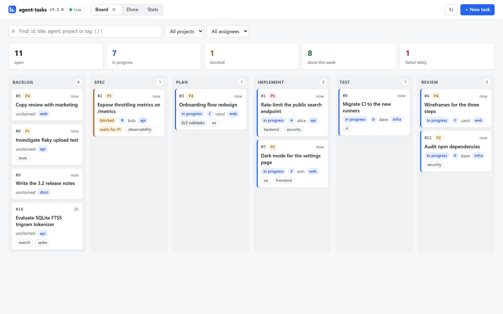
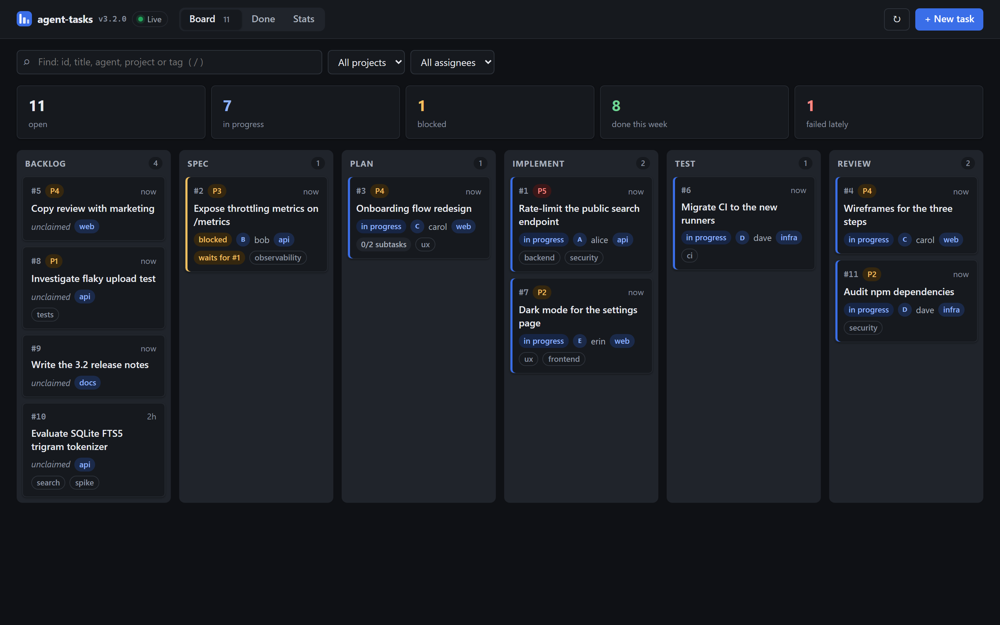
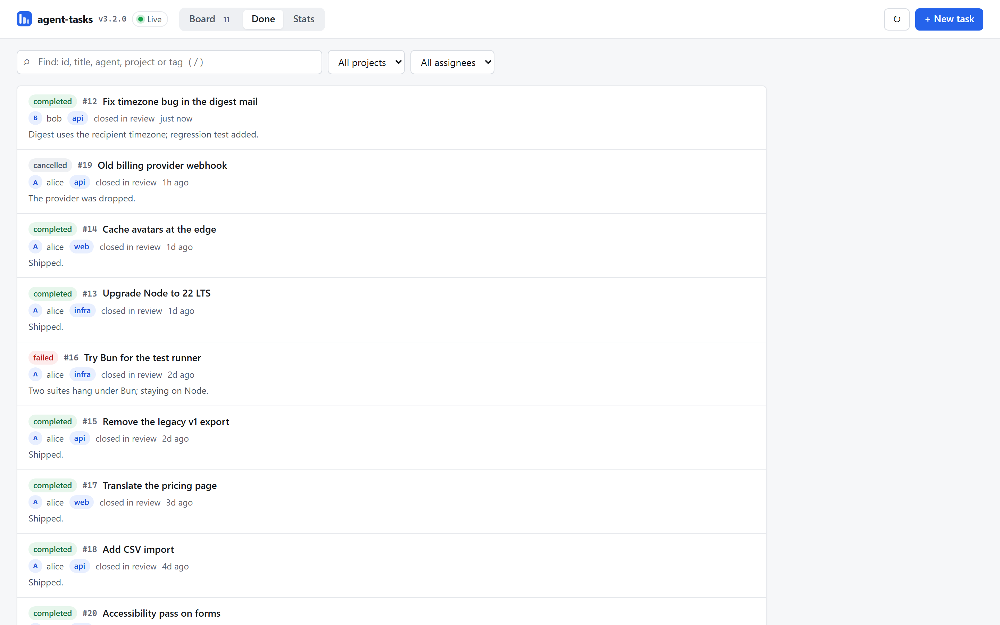
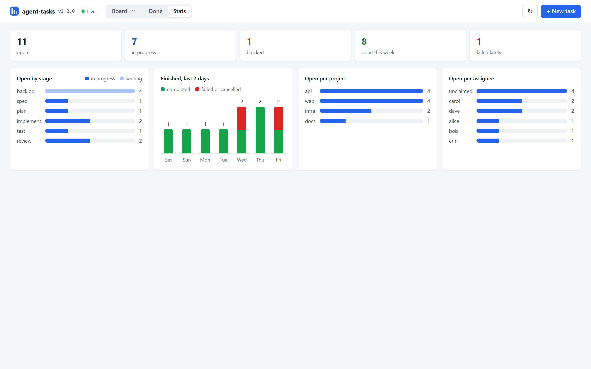
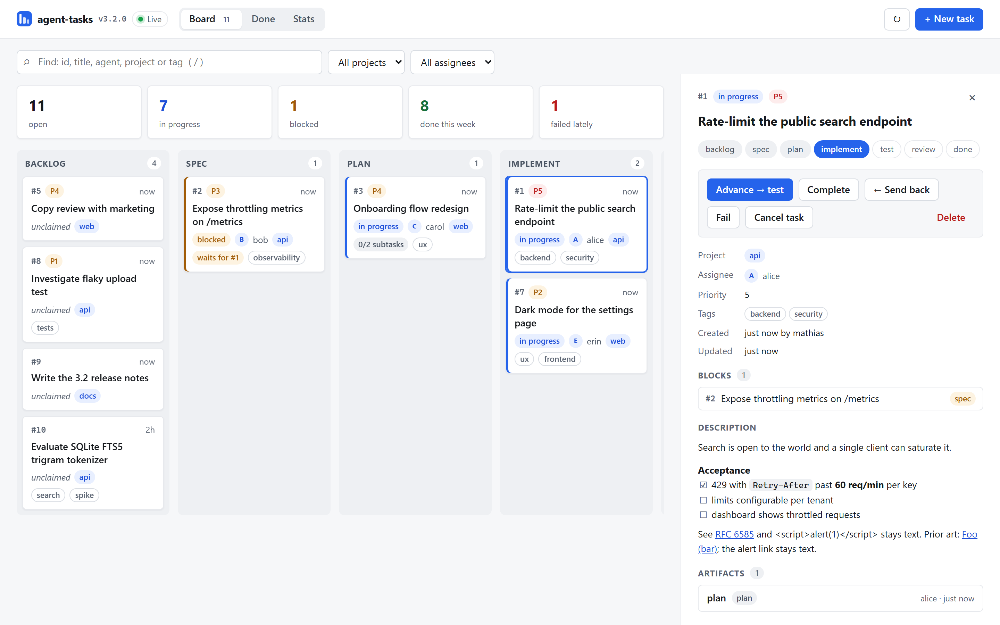
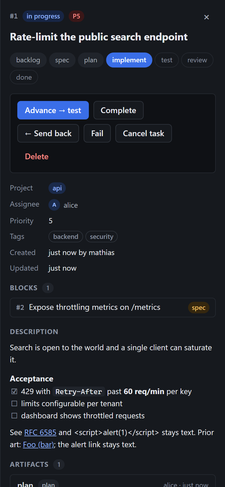
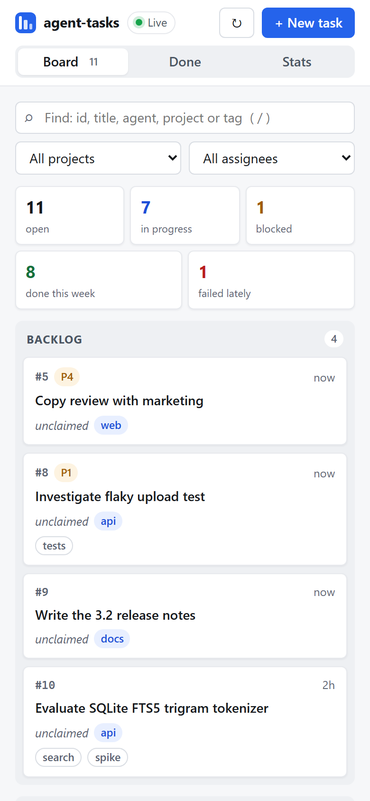
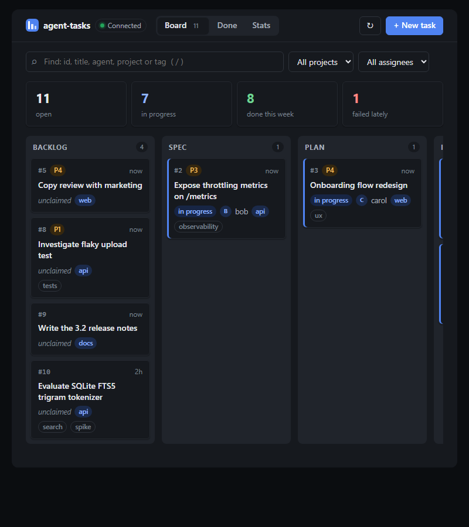
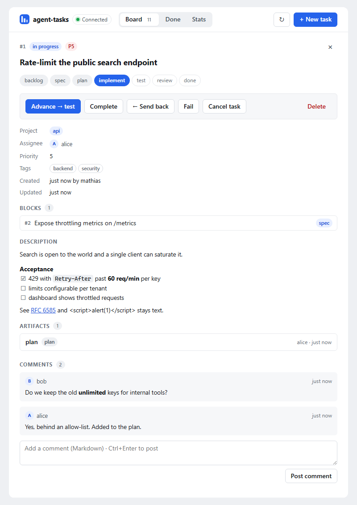

# Dashboard

agent-tasks has three faces for people: the [`/pipeline` pane](USER-MANUAL.md#4-the-pipeline-pane) inside Claude Code, a **web dashboard** for every other tool (Codex, Cursor, OpenCode, Aider, or just a browser), and an **MCP Apps view** that hosts such as Claude Desktop, claude.ai and VS Code draw inline in the chat. The dashboard and the MCP Apps view are one app with the same views and actions; only where the data comes from differs (REST, or the host's tool calls).



## Opening it

The REST server serves the dashboard at **http://127.0.0.1:3422/** (`AGENT_TASKS_PORT` changes the port).

```bash
npx agent-tasks dashboard            # prints the URL and opens the browser
npx agent-tasks dashboard --no-open  # only prints it
```

The REST server runs while any agent-tasks MCP process runs: the first one to start holds the port, the others take over when it exits. With no MCP process running, `npx agent-tasks dashboard` starts the REST server itself and serves the dashboard until Ctrl+C. `GET /health` names the URL as `dashboard_url`, which is what the `/pipeline` pane links to.

Actions from the dashboard are made as `AGENT_TASKS_USER`, else the OS user (`/health` says who as `user`): new tasks are created by them, comments and stage moves carry their name.

### With Codex

Add agent-tasks to `~/.codex/config.toml` (or `codex mcp add agent-tasks -- npx -y agent-tasks`):

```toml
[mcp_servers.agent-tasks]
command = "npx"
args = ["-y", "agent-tasks"]

[mcp_servers.agent-tasks.env]
AGENT_TASKS_USER = "your-name"
```

Once Codex starts the MCP server, the dashboard is up on the port; keep it open beside the terminal. Cursor, OpenCode, Windsurf and others are set up the same way ([SETUP.md](SETUP.md)); the dashboard does not care which client started the server.

## Board

A column per pipeline stage, a card per open task: its id, priority (`P5`), how long since it last changed, the title, its state (in progress, pending, blocked; an unclaimed one shows only `unclaimed`), the assignee, project, tags, the tasks it waits for and its subtask progress. Tasks in progress come first in a column and carry a blue edge; blocked ones an amber edge. Above the board, tiles count what is open, in progress, blocked, done this week and failed lately.



**Filters.** Find (`/` jumps there) matches the id, title, assignee, project and tags; `#12` finds task 12 only. The project and assignee pickers narrow the board and Done; Clear drops all three. They are not kept across reloads.

**Done** lists the recently finished tasks, newest first: outcome, who, project, the stage it was closed in, when, and the result.



**Stats** draws open tasks by stage (in progress and waiting), tasks finished per day over the last week (completed, and failed or cancelled), and open tasks per project and per assignee, as bars laid out by CSS (their text keeps its size at any width), each chart one image with a text alternative.



## Task detail

Pressing a card opens the task beside the board (on narrower screens over it); the URL follows (`#/board/12`), so back, forward and links work. Escape closes it and returns focus to its card.



From top to bottom: the stage strip, the actions, the result (when finished), facts (project, assignee, priority, tags, created, updated), the parent, what it waits for, what it blocks, related and duplicate tasks, subtasks (each opens that task), the description, artifacts (newest version of each, folded; Markdown) and comments with a field to add one (Ctrl+Enter posts).

Markdown (descriptions, artifacts, comments, results) is drawn as text nodes only: headings, lists, task lists, tables, code, quotes, links (http, https, mailto) and emphasis. Raw HTML in a task shows as the text it is.

### Actions

The dashboard offers what the `/pipeline` pane offers, under the same rules:

| Action          | When                                                  | What it asks                     |
| --------------- | ----------------------------------------------------- | -------------------------------- |
| Advance → stage | in progress, nothing it waits for, no agent-only gate | nothing (sends the stage it saw) |
| Complete        | same                                                  | the result                       |
| ← Send back     | open and past the first stage                         | the stage, and why (optional)    |
| Fail            | in progress                                           | what went wrong                  |
| Cancel task     | open                                                  | the reason                       |
| Reopen          | finished                                              | nothing                          |
| Delete          | always; refused while a subtask is open               | a confirmation                   |

An unclaimed task has no Advance: agents claim with `task_stage`. A blocked task says what it waits for instead. A stage gate is said under the actions, with who gives what it needs. A refusal from the server (the task moved meanwhile, a gate) shows at the top and leaves the form with its words open.

**New task** (top right) asks for the title, a description (Markdown), project (suggesting the known ones), priority and tags, and opens the new task.



## Live

The dashboard polls `GET /api/board` (and the open task) every 3 s while the tab is visible, and at once when it becomes visible again, so what any agent does shows within seconds. The header says `Live`; when the server stops answering it says `Offline`, the board stays as last seen under a notice, New task is off, and it comes back by itself (or with Try again) once the server is up.

## Look and access

- Light and dark follow the system (`prefers-color-scheme`); system fonts, an 8 px spacing scale, 6 px radius, 1 px borders, accent `#2563eb` (`#3a6ee8` in dark); text, filled buttons and pills at WCAG AA contrast in both; the design language shared with the agent-knowledge and agent-discover dashboards.
- From 375 px phones (columns stack, the detail fills the screen) to wide screens.
- Keyboard: every control is a button, link or field in a sensible order, focus is always visible, `/` finds, Escape closes, the detail takes focus when it opens and gives it back to the card; after an action focus stays in the task (on a control that opens a form, never one that acts at once), after a delete on the board. Regions, charts and controls carry labels.



## Security

The dashboard is same-origin with the API and needs no exception beyond that:

- Requests are checked as for every REST call: `Host` must be a loopback name with the port (DNS rebinding), bodies of mutations must be `application/json`.
- An `Origin` is accepted only when it is the server's own origin as the request reached it (`http://127.0.0.1:3422` for a page loaded from there). Every other page, a loopback one on another port or under another host name included, gets 403, and no CORS headers are sent.
- The page is served with `Content-Security-Policy: default-src 'none'; script-src 'self'; style-src 'self'; connect-src 'self'; img-src data:; base-uri 'none'; form-action 'none'; frame-ancestors 'none'`, plus `X-Frame-Options: DENY`, `nosniff` and `no-referrer`. It loads nothing from elsewhere.
- No task text ever becomes HTML (`tests/widget.test.ts` keeps `innerHTML` and the like out of the UI sources).

## MCP Apps view

`task_list`, `task_get` and `task_create` point MCP Apps hosts at `ui://agent-tasks/app.html` (`_meta.ui.resourceUri`). A host that supports MCP Apps draws their results inline:

- a `task_list` result as the board of the listed tasks (Board, Done and Stats; Refresh calls `task_list` again with the same arguments),
- a `task_get` or `task_create` result (or `task_list` with `next`) as that task's detail.

The actions are the dashboard's, made through the tools (`task_stage`, `task_artifact`, `task_create`, `task_delete`) under the session's name. The view is one self-contained HTML file (script and styles inline, no requests), takes the host's theme and style variables, and is built with the official `@modelcontextprotocol/ext-apps` client. Hosts without MCP Apps keep reading the JSON text.





## For developers

- Sources: `src/ui/` (plain browser JavaScript and one stylesheet; `app.js` the app, `views/`, `lib/`), `dashboard.js` (REST source, hash routes) and `widget.js` (tool-call source). `src/ui/build.mjs` (esbuild) writes `dist/ui/index.html`, `app.js`, `app.css` and the self-contained `widget.html`; `npm run build` runs it after `tsc`.
- Serving: `src/transport/rest.ts` (`GET /` and assets), the guard in `src/transport/guard.ts`, the MCP Apps wiring in `src/transport/widget.ts`.
- Tests: `tests/widget.test.ts` (host contract, the data and view the widget reads from real results, build), `tests/ui-model.test.ts`, `tests/guard.test.ts`, `tests/rest.test.ts`, `tests/dashboard-cli.test.ts`; `npm run e2e:web` runs the Playwright suites in `tests/e2e-web/` (every dashboard flow against a real server on a scratch database and port, and the widget under an ext-apps AppBridge host).
- Screenshots: `npx tsx tests/e2e-web/shoot.ts` writes this page's images to `docs/images/dashboard/`; the widget's come from `tests/e2e-web/widget.pw.ts` (into `~/.claude/tmp/at-web/`).
