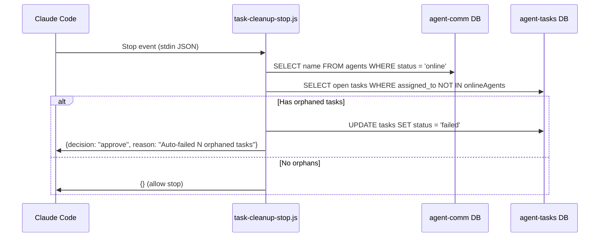
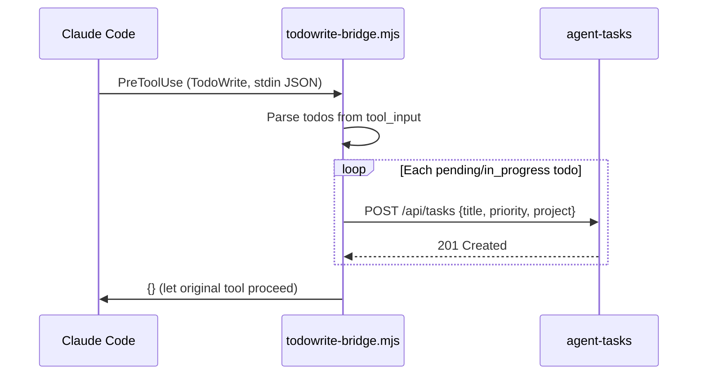

# Setup Guide

Detailed instructions for installing, configuring, and integrating agent-tasks with any MCP client.

## Table of Contents

- [Prerequisites](#prerequisites)
- [Installation](#installation)
- [Client Setup](#client-setup)
  - [Claude Code](#claude-code)
  - [OpenCode](#opencode)
  - [Cursor](#cursor)
  - [Windsurf](#windsurf)
  - [REST API](#rest-api)
- [Hooks](#hooks)
  - [Claude Code Hooks](#claude-code-hooks)
  - [OpenCode Plugins](#opencode-plugins)
  - [Cursor and Windsurf](#cursor-and-windsurf)
- [Running as Standalone Server](#running-as-standalone-server)
- [Configuration Options](#configuration-options)
- [Database](#database)
- [Troubleshooting](#troubleshooting)

---

## Prerequisites

- **Node.js** >= 20.11 (for native ES module support and `node:` built-in imports)
- **npm** >= 10

```bash
node --version   # v20.11.0 or later
npm --version    # v10 or later
```

---

## Installation

### From npm

```bash
npm install -g agent-tasks
```

### From source

```bash
git clone https://github.com/keshrath/agent-tasks.git
cd agent-tasks
npm install
npm run build
```

This compiles TypeScript to `dist/`.

### Verify

```bash
node dist/server.js
curl http://localhost:3422/health
```

You should get `{"status":"ok","version":"...","tasks":0,...}`.

---

## Client Setup

agent-tasks works with any MCP client (stdio) or HTTP client (REST API). Pick your client below.

### Claude Code

#### Plugin (recommended)

```bash
claude plugin marketplace add keshrath/agent-tasks
claude plugin install agent-tasks@agent-tasks
```

The plugin runs the MCP server and adds the `/pipeline` pane (a Claude Code mod, Claude Code 2.1.289+): type `/pipeline` to open the board beside the conversation. The hook scripts below are not part of the plugin; add them by hand, or with `node scripts/setup.js` — which also registers the MCP server in `~/.claude.json`, so with the plugin installed remove that entry afterwards (`claude mcp remove agent-tasks -s user`) or the server runs twice.

#### Script setup

From the agent-tasks clone:

```bash
node scripts/setup.js
```

This detects Claude Code, registers the MCP server in `~/.claude.json`, wires all 5 hooks into `~/.claude/settings.json`, and grants `mcp__agent-tasks__*` permission in one shot. Restart Claude Code afterwards to pick up the new config.

#### Step 1: Add the MCP server (manual)

Register the server in `~/.claude.json` (user scope; `claude mcp add agent-tasks -s user -- npx agent-tasks` writes the same entry):

```json
{
  "mcpServers": {
    "agent-tasks": {
      "command": "npx",
      "args": ["agent-tasks"]
    }
  }
}
```

and allow its tools in `~/.claude/settings.json`:

```json
{
  "permissions": {
    "allow": ["mcp__agent-tasks__*"]
  }
}
```

#### Step 2: Verify

Start a new Claude Code session. Try:

> Create a task called "Test task" with priority 5

Claude should call `task_create` and confirm the task was created.

#### Step 3: The board

One MCP process serves the REST API on **http://localhost:3422** (another takes over when it exits). With the plugin installed, `/pipeline` shows the board in Claude Code.

### OpenCode

`opencode.json` (project root) or `~/.config/opencode/opencode.json` (global):

```json
{
  "$schema": "https://opencode.ai/config.json",
  "mcp": {
    "agent-tasks": {
      "type": "local",
      "command": ["node", "/absolute/path/to/agent-tasks/dist/index.js"],
      "environment": {
        "AGENT_TASKS_PORT": "3422"
      }
    }
  }
}
```

### Cursor

`.cursor/mcp.json` in your project root:

```json
{
  "mcpServers": {
    "agent-tasks": {
      "command": "node",
      "args": ["/absolute/path/to/agent-tasks/dist/index.js"],
      "env": {
        "AGENT_TASKS_PORT": "3422"
      }
    }
  }
}
```

### Windsurf

`~/.codeium/windsurf/mcp_config.json`:

```json
{
  "mcpServers": {
    "agent-tasks": {
      "command": "node",
      "args": ["/absolute/path/to/agent-tasks/dist/index.js"],
      "env": {
        "AGENT_TASKS_PORT": "3422"
      }
    }
  }
}
```

### REST API

If your tool doesn't support MCP, the REST API covers creating, reading one task, the lifecycle actions, comments and delete (everything else is MCP only):

```bash
# Create a task
curl -X POST http://localhost:3422/api/tasks \
  -H 'Content-Type: application/json' \
  -d '{"title": "Fix login bug", "priority": 5, "project": "backend"}'

# Read a task
curl http://localhost:3422/api/tasks/1

# Advance a task to plan
curl -X POST http://localhost:3422/api/tasks/1/stage   -H 'Content-Type: application/json'   -d '{"action": "advance", "stage": "plan", "by": "me"}'
```

See [API.md](API.md) for the full REST reference.

---

## Hooks

Hooks automate pipeline workflows — session announcements, TodoWrite bridging, and task cleanup. Support varies by client.

### Claude Code Hooks

agent-tasks ships **5 hook scripts**. `scripts/setup.js` installs them automatically; the block below shows the manual equivalent for `~/.claude/settings.json`:

```json
{
  "hooks": {
    "SessionStart": [
      {
        "hooks": [
          {
            "type": "command",
            "command": "node \"/path/to/agent-tasks/scripts/hooks/session-start.js\"",
            "timeout": 5
          },
          {
            "type": "command",
            "command": "node \"/path/to/agent-tasks/scripts/hooks/task-cleanup-start.js\"",
            "timeout": 10
          }
        ]
      }
    ],
    "UserPromptSubmit": [
      {
        "hooks": [
          {
            "type": "command",
            "command": "node \"/path/to/agent-tasks/scripts/hooks/pipeline-enforcer.mjs\"",
            "timeout": 10
          }
        ]
      }
    ],
    "PreToolUse": [
      {
        "matcher": "TodoWrite",
        "hooks": [
          {
            "type": "command",
            "command": "node \"/path/to/agent-tasks/scripts/hooks/todowrite-bridge.mjs\"",
            "timeout": 5
          }
        ]
      }
    ],
    "Stop": [
      {
        "hooks": [
          {
            "type": "command",
            "command": "node \"/path/to/agent-tasks/scripts/hooks/task-cleanup-stop.js\"",
            "timeout": 10
          }
        ]
      }
    ],
    "SubagentStop": [
      {
        "hooks": [
          {
            "type": "command",
            "command": "node \"/path/to/agent-tasks/scripts/hooks/task-cleanup-stop.js\"",
            "timeout": 10
          }
        ]
      }
    ]
  }
}
```

Replace `/path/to/agent-tasks` with the actual path.

| Hook                    | Event                  | Purpose                                        |
| ----------------------- | ---------------------- | ---------------------------------------------- |
| `session-start.js`      | SessionStart           | Points at the MCP tools and `/pipeline`        |
| `task-cleanup-start.js` | SessionStart           | Auto-fails tasks from dead sessions            |
| `pipeline-enforcer.mjs` | UserPromptSubmit       | Reminds when no pipeline task is active        |
| `todowrite-bridge.mjs`  | PreToolUse (TodoWrite) | Syncs TodoWrite todos to pipeline              |
| `task-cleanup-stop.js`  | Stop + SubagentStop    | Auto-fails orphaned tasks; never blocks a stop |

See [`docs/hooks.md`](hooks.md) for the full hook reference including the work-prompt classifier, environment variables, and test coverage.

#### Task Cleanup — Stop (`scripts/hooks/task-cleanup-stop.js`)

Sweeps for tasks assigned to sessions that are no longer online and auto-fails them. Runs on both `Stop` (main session) and `SubagentStop` (spawned agents), complementing the `SessionStart` sweep.

The hook does **not** block the stop. Claude Code's Stop event does not carry enough metadata to reliably identify which agent-comm session is stopping (multiple sessions share the same Claude install), so attributing "your" open tasks to the stopping session was error-prone — it frequently flagged sibling sessions' work. The hook now only cleans up tasks owned by agents whose agent-comm status is no longer `online`, and skips the sweep entirely when agent-comm's DB (`AGENT_COMM_DB`, default `~/.agent-comm/agent-comm.db`) cannot be read.



Open tasks whose assigned agent is still online are left untouched — their session is assumed to be alive and actively working on them.

#### Task Cleanup — Session Start (`scripts/hooks/task-cleanup-start.js`)

Catches tasks orphaned by sessions that crashed, were killed, or otherwise ended without the Stop hook firing.

On every session start:

1. Finds all tasks assigned to sessions that are no longer online in the agent-comm DB
2. Auto-fails them with reason `"Session no longer running (stale task cleanup on session start)"`
3. Logs the cleanup to stderr

This is the safety net — even if the Stop hook never fires, the next session to start will clean up.

#### TodoWrite Bridge (`scripts/hooks/todowrite-bridge.mjs`)

Intercepts Claude Code's built-in `TodoWrite` tool and syncs todos to agent-tasks. Every todo Claude creates appears on the `/pipeline` board.

When Claude Code calls `TodoWrite`, the hook:

1. Reads the tool input from stdin
2. Extracts todos with `in_progress` or `pending` status
3. POSTs each as a new task to `http://localhost:3422/api/tasks`
4. Maps priority: `high` -> 5, `medium` -> 3, `low` -> 1
5. Files all synced tasks under project `claude-todos` with tags `synced`, `todowrite`
6. Returns an empty JSON object to let the original tool proceed



| Variable          | Default                 | Description                   |
| ----------------- | ----------------------- | ----------------------------- |
| `AGENT_TASKS_URL` | `http://localhost:3422` | agent-tasks REST API base URL |

The hook has a 3-second timeout per request. If agent-tasks is not running, it silently fails and lets `TodoWrite` proceed.

### OpenCode Plugins

OpenCode supports lifecycle hooks via JavaScript/TypeScript plugins. Create a plugin in `.opencode/plugins/` or `~/.config/opencode/plugins/`:

```typescript
// .opencode/plugins/agent-tasks.ts
import type { Plugin } from '@opencode-ai/plugin';

export const AgentTasksPlugin: Plugin = async ({ client }) => {
  return {
    event: async (event) => {
      if (event.type === 'session.created') {
        // Equivalent to SessionStart — agent sees pipeline instructions via AGENTS.md
      }
      if (event.type === 'tool.execute.before') {
        // Equivalent to PreToolUse — could intercept todo creation
      }
    },
  };
};
```

Available events: `session.created`, `session.idle`, `tool.execute.before`, `tool.execute.after`, `message.updated`, `file.edited`.

Combine with `AGENTS.md` instructions (see below).

### Cursor and Windsurf

Cursor and Windsurf don't support lifecycle hooks. Use the client's system prompt / instructions file (see [Agent Rules](#agent-rules) below).

The TodoWrite bridge is Claude Code-specific. Other clients should use `task_create` directly.

---

## Agent Rules

Hooks enforce task cleanup and TodoWrite bridging, but every platform needs **written instructions** telling the agent how to use the pipeline. Without rules, agents create tasks but skip stages or forget to advance.

Add the appropriate block to your platform's instructions file:

| Platform    | File                                                |
| ----------- | --------------------------------------------------- |
| Claude Code | `CLAUDE.md` (project root or `~/.claude/CLAUDE.md`) |
| OpenCode    | `AGENTS.md` (project root)                          |
| Cursor      | `.cursorrules` (project root)                       |
| Windsurf    | `.windsurfrules` (project root)                     |

### Recommended instructions (copy-paste)

```markdown
## Dev Pipeline

All work flows through a shared pipeline (agent-tasks MCP tools; `/pipeline` shows the board).

Pipeline stages: **backlog → spec → plan → implement → test → review → done**

### How to use

1. **Check for work first** — call `task_list` to see what's in flight
2. **Create tasks** — `task_create` with title, description, priority, project
3. **Claim it** — `task_stage` with `action: "claim"` assigns it to your session and advances from backlog
4. **Do the work** — advance through stages with `task_stage` (`action: "advance"`)
5. **Attach artifacts** — at each stage, use `task_artifact` (specs, plans, code summaries, test results)
6. **Complete** — `task_stage` with `action: "complete"` when done, or `action: "fail"` if abandoned

### Rules

- **Never work without a task** — if there isn't one, create it
- **Never skip stages** — move through spec → plan → implement → test → review
- **Attach artifacts at each stage** — the pipeline is only useful if it shows what was decided/built/tested
- **Always complete or fail your tasks before stopping**
- Break large work into sub-tasks with `task_create` (`parent_id`) or dependencies via `task_update` (`dependency` field)

### Communicate around tasks (requires agent-comm)

If agent-comm is available, coordinate task work with other agents:

- **Claiming a task** — post to "general": "Claiming task #42: implement auth module"
- **Advancing a stage** — post to "general": "Task #42 moved to test — all unit tests passing"
- **Blocked on a dependency** — post to "general": "Blocked on task #38, need the DB schema first"
- **Editing shared files** — use `comm_state_set("locks", "path/to/file", "my-name")` before editing, `comm_state_delete` when done
- **Finishing work** — post a summary to "general" before stopping

See the [agent-comm SETUP guide](https://github.com/keshrath/agent-comm/blob/main/docs/SETUP.md) for full communication instructions.
```

### Why this matters

Without these rules, agents typically:

- Create a task and jump straight to "done" (skipping stages)
- Never attach artifacts (the pipeline shows nothing useful)
- Forget to complete/fail tasks when stopping (leaves orphans)
- Work on the same files as other agents without coordinating (merge conflicts)

Hooks help enforce cleanup in Claude Code, but the written rules drive the actual workflow discipline.

---

## Running as Standalone Server

```bash
# Default port (3422)
npm run start:server

# Custom port
npm run start:server -- --port 8080

# Or directly
node dist/server.js --port 8080
```

Useful for integrating via the REST API, or for serving the `/pipeline` pane on a custom port (set the same `AGENT_TASKS_PORT` for Claude Code).

---

## Configuration Options

### Environment variables

| Variable                                 | Default                         | Description                                                                                                    |
| ---------------------------------------- | ------------------------------- | -------------------------------------------------------------------------------------------------------------- |
| `AGENT_TASKS_DB`                         | `~/.agent-tasks/agent-tasks.db` | Path to the SQLite database file                                                                               |
| `AGENT_TASKS_PORT`                       | `3422`                          | REST API port the MCP processes serve and the `/pipeline` pane reads (`dist/server.js` takes `--port` instead) |
| `AGENT_TASKS_HOST`                       | `127.0.0.1`                     | REST bind address (`0.0.0.0` exposes it to the network)                                                        |
| `AGENT_TASKS_USER`                       | the OS user                     | Who the `/pipeline` pane acts as (`created_by`, comment author, `by`)                                          |
| `AGENT_TASKS_INSTRUCTIONS`               | enabled                         | Set to `0` to disable embedded instructions in MCP tool responses                                              |
| `AGENT_TASKS_RETENTION_DAYS`             | `30`                            | Days the cleanup keeps resolved approval records                                                               |
| `AGENT_TASKS_DEAD_SESSION_GRACE_MINUTES` | `60`                            | `task-cleanup-start.js`: idle minutes before a dead session's task is failed                                   |
| `AGENT_TASKS_HEARTBEAT_FRESH_MINUTES`    | `15`                            | `task-cleanup-start.js`: an agent with a heartbeat this recent counts as alive                                 |
| `AGENT_COMM_URL`                         | `http://localhost:3421`         | Agent-comm REST API URL (for bridge notifications and heartbeat cleanup)                                       |
| `AGENT_KNOWLEDGE_URL`                    | `http://localhost:3423`         | Agent-knowledge REST API URL (learnings and decisions pushed on completion)                                    |

### Agent-comm integration

agent-tasks integrates with [agent-comm](https://github.com/keshrath/agent-comm) for two features:

1. **Bridge notifications** — when tasks are claimed, advanced, or commented on, agent-tasks sends messages to affected agents via agent-comm
2. **Heartbeat-based cleanup** — agent-tasks queries agent-comm's `GET /api/agents` endpoint to check agent liveness, and auto-fails tasks assigned to dead agents

To enable:

1. Install and start agent-comm (default port: 3421)
2. Set `AGENT_COMM_URL` if using a non-default URL
3. agent-tasks checks heartbeats on startup (10s delay) and when `task_config` is called with `action: "cleanup"` and `mode: "stale_agents"` or `mode: "all"`

If agent-comm is not running, both features degrade gracefully — notifications are silently dropped and stale agent detection is skipped.

### Custom pipeline stages

The default pipeline is: `backlog` > `spec` > `plan` > `implement` > `test` > `review` > `done`

You can customize stages per project with the `task_config` MCP tool (`action: "pipeline"`):

```
Use task_config with action "pipeline" to set stages for project "my-project" to: ["todo", "doing", "testing", "done"]
```

Or via REST:

```bash
# Get current pipeline config
curl http://localhost:3422/api/pipeline

# Get pipeline for a specific project
curl http://localhost:3422/api/pipeline?project=my-project
```

### Per-stage gate guards

Gate guards enforce quality requirements before tasks can advance to the next stage. Configure via `task_config` (`action: "pipeline"`):

```
Use task_config with action "pipeline" to set gate_config for project "backend" with gates:
- implement stage requires artifact named "code-summary"
- test stage requires artifact named "test-results" and a comment
```

This translates to:

```json
{
  "gate_config": {
    "gates": {
      "implement": {
        "require_artifacts": ["code-summary"],
        "require_min_artifacts": 1
      },
      "test": {
        "require_artifacts": ["test-results"],
        "require_comment": true
      }
    }
  }
}
```

| Gate option             | Type       | Description                                                                                                          |
| ----------------------- | ---------- | -------------------------------------------------------------------------------------------------------------------- |
| `require_artifacts`     | `string[]` | Named artifacts that must exist at the current stage                                                                 |
| `require_min_artifacts` | `number`   | Minimum number of artifacts at the current stage                                                                     |
| `require_comment`       | `boolean`  | At least one comment must exist on the task                                                                          |
| `require_approval`      | `boolean`  | An approved approval must exist for the current stage. No MCP tool or REST route records approvals, so leave it off. |

If a gate check fails, `task_stage` (with `action: "advance"`) returns an error explaining what's missing.

---

## Database

### Location

By default, the database is stored at `~/.agent-tasks/agent-tasks.db`. Override with `AGENT_TASKS_DB`.

### Backup

```bash
cp ~/.agent-tasks/agent-tasks.db ~/.agent-tasks/agent-tasks.db.bak
```

### Reset

```bash
rm ~/.agent-tasks/agent-tasks.db
```

A new database will be created automatically on the next start.

### Schema

The database uses schema versioning (currently V5) with automatic migrations. Migrations are idempotent.

---

## Troubleshooting

### `/pipeline` says the REST API is not reachable

- Verify the server is running: `curl http://localhost:3422/health`
- Check the port isn't in use: `lsof -i :3422` (macOS/Linux) or `netstat -ano | findstr 3422` (Windows)
- Try a different port: `npm run start:server -- --port 8080`, and set `AGENT_TASKS_PORT=8080` for Claude Code so the pane finds it

### MCP tools not appearing

- Verify the path in your config is absolute and points to `dist/index.js`
- Ensure you ran `npm run build` after cloning
- Restart your client after changing config

### Tasks not syncing between terminals

- Every MCP process writes the same SQLite database; the `/pipeline` pane polls the REST API, so changes show up within one poll
- Ensure all MCP instances use the same database file (`AGENT_TASKS_DB`)

### TodoWrite bridge not working

- Verify the hook script path is absolute in `settings.json`
- Check that the agent-tasks server is running (the bridge POSTs to the REST API)
- Check stderr for errors: the bridge logs to stderr with `[todowrite-bridge]` prefix

### Task cleanup hooks not working

- Both cleanup hooks require `better-sqlite3` (included in agent-tasks dependencies — run `npm install` in the agent-tasks directory)
- The stop hook identifies sessions via the agent-comm DB — ensure your session calls `comm_register` on startup
- Check stderr for `[task-cleanup-start]` messages on session start

## Client Comparison

| Feature             | Claude Code | OpenCode      | Cursor       | Windsurf       |
| ------------------- | ----------- | ------------- | ------------ | -------------- |
| MCP stdio transport | Yes         | Yes           | Yes          | Yes            |
| Lifecycle hooks     | Yes (JSON)  | Yes (plugins) | No           | No             |
| TodoWrite bridge    | Yes         | No            | No           | No             |
| System prompt file  | CLAUDE.md   | AGENTS.md     | .cursorrules | .windsurfrules |
| REST API fallback   | Yes         | Yes           | Yes          | Yes            |
