# Tutorial: the /pipeline pane in Claude Code

A walk through the pane in the real Claude Code CLI, with the pane docked beside the conversation (the fullscreen layout). Every picture below is a frame of a recorded session against a scratch board; `npx tsx tests/e2e-claude/tutorial.ts --docs` records it again, writes a captioned video (`pipeline-tutorial.webm`) and the stills to `~/.claude/tmp/pane-shots-tasks/tutorial/`, and copies the stills here.

This is the guided walk. The [user manual](USER-MANUAL.md#4-the-pipeline-pane) is the reference: every view, action and state of the pane, with a screenshot each and a short clip of every flow.

The pane is keyboard-first. A few keys get you everywhere:

| Key                  | Does                                                 |
| -------------------- | ---------------------------------------------------- |
| `1` `2` `3`          | Board, Done, New (again: back to its first row)      |
| `Tab` / `shift+Tab`  | move the focus (the highlighted button or field)     |
| `Enter`              | press what has the focus                             |
| `↑` `↓`              | scroll the pane                                      |
| `r`                  | refresh                                              |
| `Esc` / `ctrl+x tab` | give the keyboard back to the prompt / take it again |

While the focus is in a text field, digits and letters go into the field, and the line under the tabs says `Tab leaves the field` instead of the keys (`Tab next field` in the New form); `Tab` leaves it. With the mouse (fullscreen layout), a click presses a button.

## 1. Open it

Type `/pipeline` and press Enter. The board opens beside the conversation with the keyboard. The status line under the prompt says what is in flight, `12 open tasks · 6 in progress · 1 blocked`, and stays there while the pane is closed.

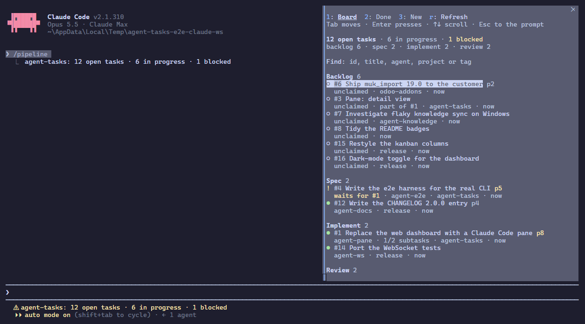

Open tasks are grouped by pipeline stage, working ones first, then by priority (`p8`). `●` is in progress, `○` waits to be claimed, `!` is blocked, with what it waits for underneath. Finished tasks are under Done. The focus starts on the first task.

`/pipeline 12` opens task 12 directly; `/pipeline <text>` opens the board filtered to what matches.

## 2. A task

`Tab` moves the focus, `Enter` opens the task under it. Its detail shows the stage strip with the current stage highlighted, what you can do with it, the tasks it blocks or waits for and the ones linked to it (`Related`, `Duplicate`), each with its own mark and stage, its tags, its description (long ones fold: `Show all`), subtasks and artifacts.

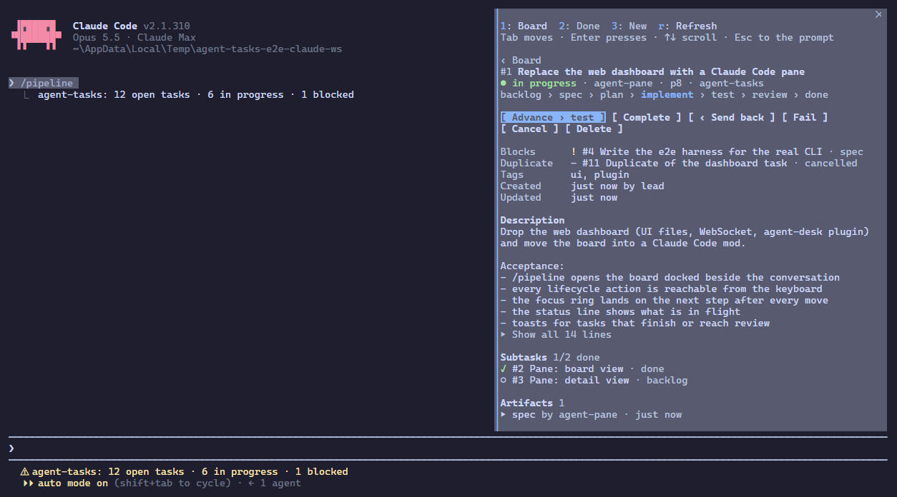

`Enter` on an artifact unfolds it as Markdown, and again folds it; the focus stays on it, and the pane scrolls to show what unfolded.

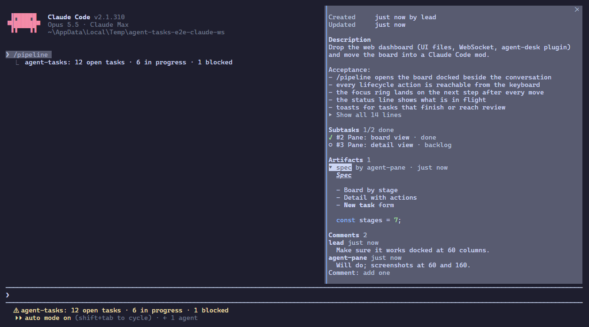

The comment field at the bottom sends a comment as you (`AGENT_TASKS_USER`, else your OS user name) for the agents working on it.

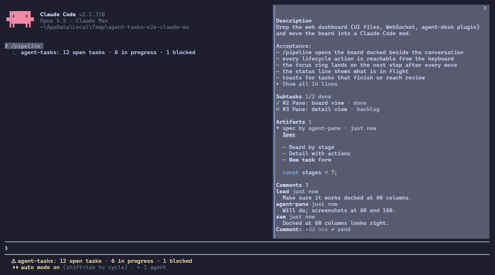

## 3. Move it through the pipeline

Agents claim tasks with `task_stage`; the pane has no Claim, and a task nobody claimed has no Advance either. For a task in progress the focus lands on its next step: `Advance › plan` moves it on.

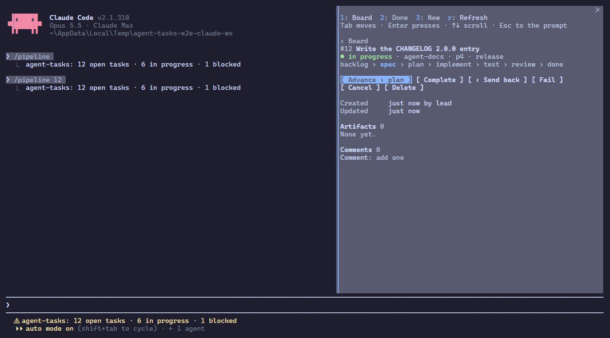

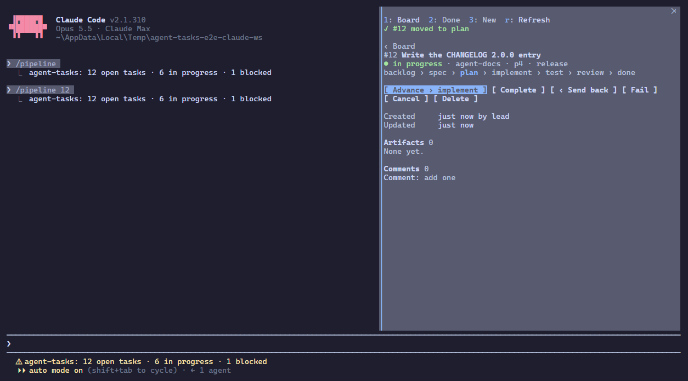

`‹ Send back` returns it to an earlier stage: pick the stage (the focus then moves on to Why), say why (kept as the rejection note), `Enter` or `Send back`. The focus lands on `‹ Board`, not on Advance, so a second `Enter` does not undo it.

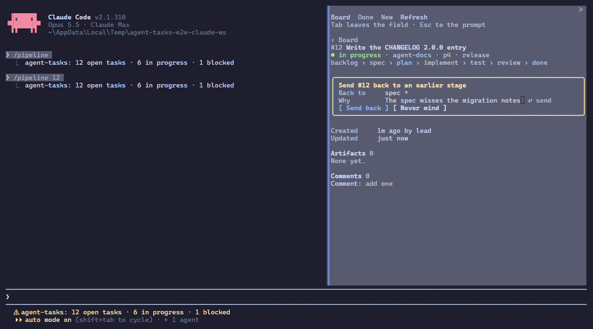

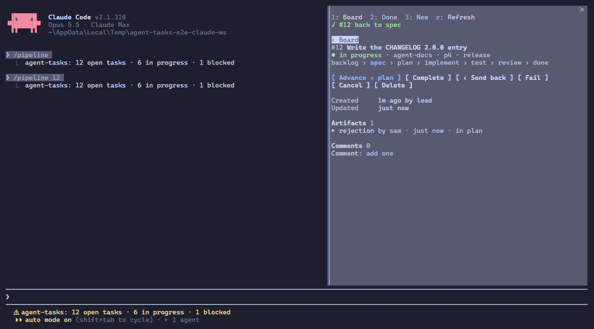

In its last stage the next step is `Complete`, which asks for the result. `Fail` asks what went wrong, `Cancel` why it is dropped. `Enter` in the field, or the form's own button (`Complete`, `Fail`, `Cancel task`, `Send back`), does it; `Never mind` closes the form. `Delete` asks first, in a red box, with the focus on `Never mind`. The line under the tabs says how it went (`✓ #13 completed`, `✗ #14 failed`, `– #15 cancelled`) and clears itself after a few seconds or at the next move.

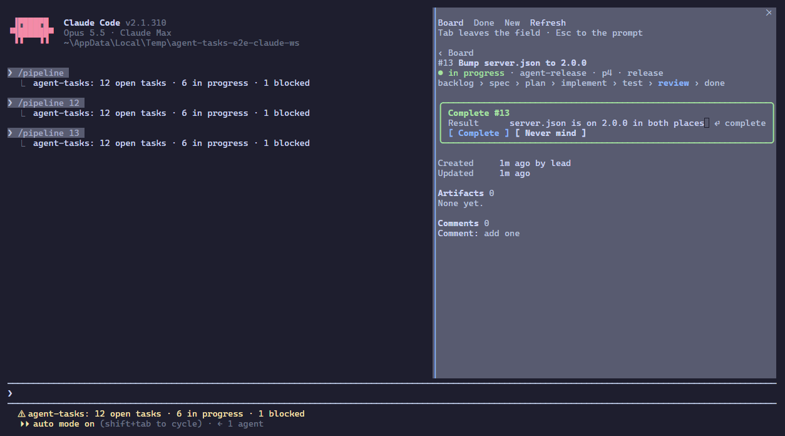

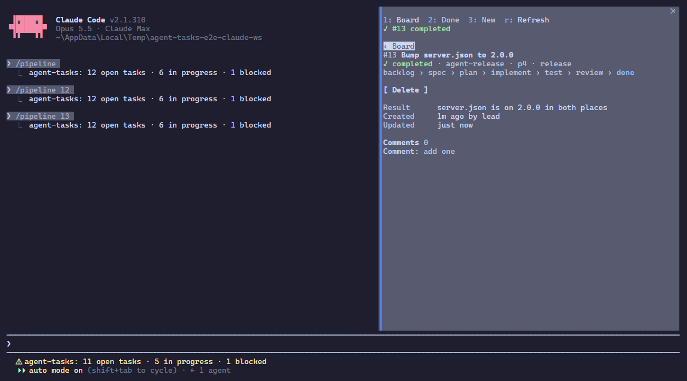

A blocked task cannot move on. Its detail says what it waits for, with the focus on that task: `Enter` opens it.

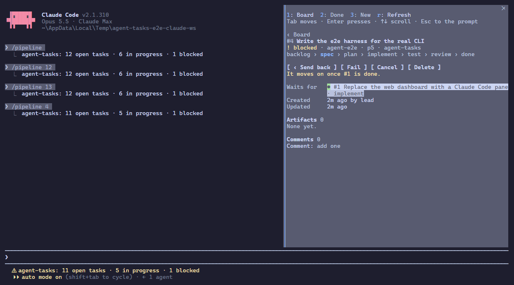

## 4. Done and New

The `2` key lists recently finished tasks, newest first: `✓` completed, `✗` failed, `–` cancelled, each with its result.

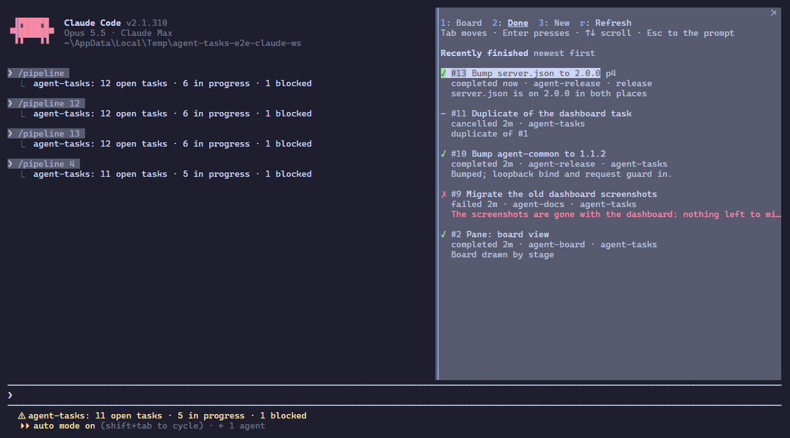

The `3` key opens a new task, focus in its title. `Enter` moves to the next field; `Enter` in Description creates the task in backlog and opens it. A priority that is no whole number is said under its field, and the focus stays there.

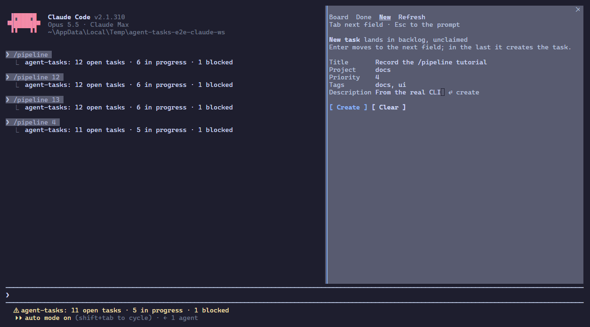

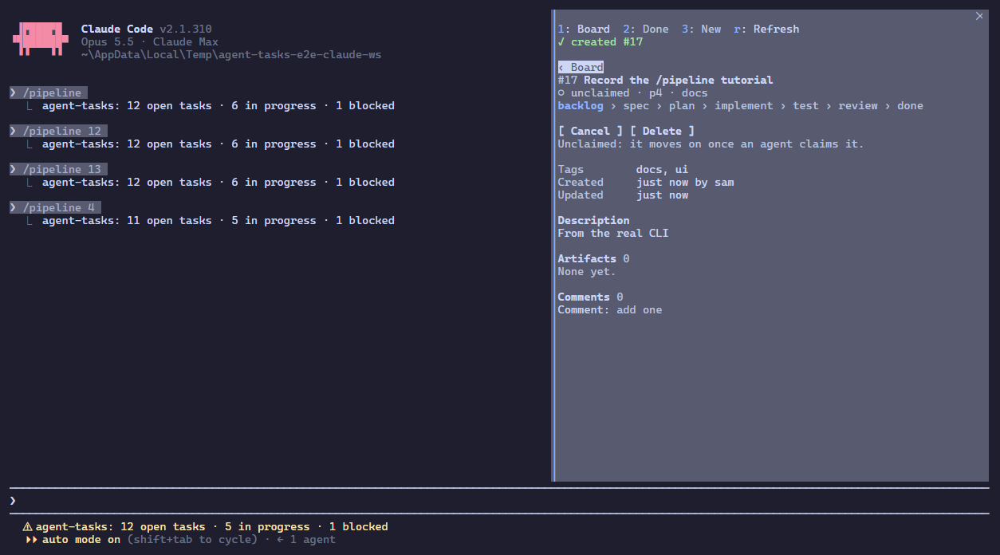

## 5. Find

On the board, Find narrows it to the tasks whose id, title, assignee, project or tags match (a row found by a tag shows that tag); `Clear the filter` shows all again.

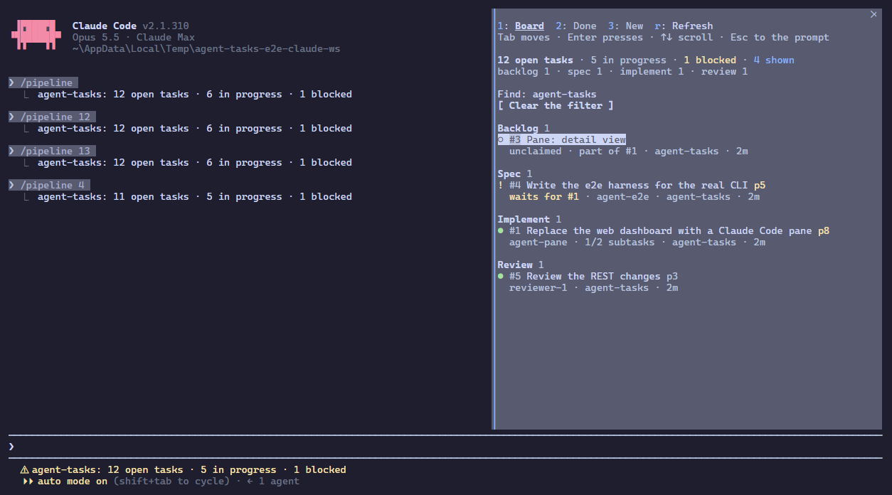

## 6. Give the keyboard back

`Esc` hands the keyboard back to the prompt; the pane stays open and keeps refreshing. `ctrl+x tab` takes it again, with the focus where you left it.

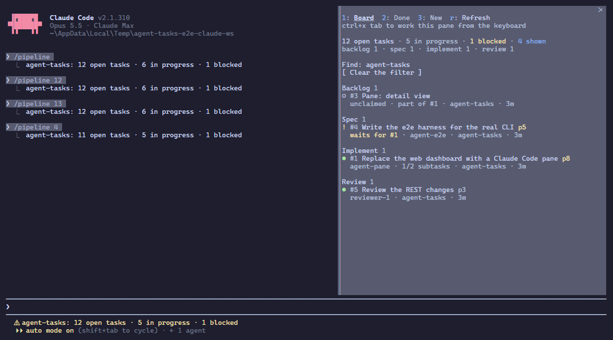

When another session finishes a task or moves one to review, a toast says so, the news first (`Done: #5 …`, `Ready for review: #1 …`), and the status line follows. If nothing answers on the REST port (no agent-tasks MCP server running), the pane says so and offers Refresh instead of showing a stale board.
