# agent-tasks User Manual

## Table of Contents

1. [Overview](#1-overview)
2. [Installation](#2-installation)
3. [Configuration](#3-configuration)
4. [The /pipeline Pane](#4-the-pipeline-pane)
5. [MCP Tools Reference](#5-mcp-tools-reference)
6. [REST API Reference](#6-rest-api-reference)
7. [Pipeline Stages and Task Lifecycle](#7-pipeline-stages-and-task-lifecycle)
8. [Troubleshooting](#8-troubleshooting)
9. [FAQ](#9-faq)

---

## 1. Overview

### What agent-tasks Does

agent-tasks is an MCP (Model Context Protocol) server that provides pipeline-driven task management for AI coding agents. Instead of flat todo lists, tasks flow through configurable stages with dependency tracking, stage gates, and multi-agent claiming:

- **Pipeline stages** -- tasks move through `backlog > spec > plan > implement > test > review > done`, configurable per project.
- **Task dependencies** -- DAG with automatic cycle detection. Blocks advancement until dependencies are resolved.
- **Multi-agent claiming** -- claim, assign, send back to an earlier stage with a reason (recorded as a `rejection` artifact under who sent it back).
- **Subtask hierarchies** -- parent/child task trees with progress tracking.
- **Threaded comments** -- async discussions between agents on any task.
- **Artifact versioning** -- per-stage document attachments with automatic versioning.
- **Decisions and learnings** -- structured decision records and insight propagation.
- **Full-text search** -- FTS5 search across task titles and descriptions.
- **Stage gates** -- configurable per-project rules requiring named artifacts, minimum artifact counts or a comment before advancing. (`require_approval` exists in the schema, but no MCP tool or REST route records an approval, so a stage with it set cannot be left; keep it off.)
- **Agent affinity** -- `task_list(next: true)` prefers routing tasks to agents with related history.
- **Claude Code `/pipeline` pane** -- the board beside the conversation: tasks by stage, task detail, every lifecycle action, a status line entry.
- **TodoWrite bridge** -- intercepts Claude Code's built-in TodoWrite and syncs to the pipeline.
- **Heartbeat-based cleanup** -- auto-fails tasks from dead agents using agent-comm heartbeat data.

### Architecture

agent-tasks has two entry points:

| Entry Point      | File             | Purpose                                                                                  |
| ---------------- | ---------------- | ---------------------------------------------------------------------------------------- |
| MCP stdio server | `dist/index.js`  | Communicates with the AI agent via JSON-RPC over stdin/stdout. Auto-starts the REST API. |
| REST server      | `dist/server.js` | Standalone REST API (what the `/pipeline` pane reads).                                   |

Internally:

```
domain/      Tasks (stages, dependencies, artifacts, claiming), events, validation
storage/     SQLite via better-sqlite3 (WAL mode, schema V5)
transport/   REST (node:http), MCP (stdio JSON-RPC)
plugin/      Claude Code plugin: MCP server config + the /pipeline mod
```

No framework dependencies -- no Express, no React. Pure Node.js + TypeScript.

---

## 2. Installation

### Prerequisites

- **Node.js 20.11.0 or later**
- **npm** (comes with Node.js)

### From npm

```bash
npm install -g agent-tasks
```

### From Source

```bash
git clone https://github.com/keshrath/agent-tasks.git
cd agent-tasks
npm install
npm run build
```

### npx (No Installation)

```bash
npx agent-tasks
```

---

## 3. Configuration

### Environment Variables

| Variable                                 | Default                         | Description                                                                    |
| ---------------------------------------- | ------------------------------- | ------------------------------------------------------------------------------ |
| `AGENT_TASKS_DB`                         | `~/.agent-tasks/agent-tasks.db` | SQLite database file path                                                      |
| `AGENT_TASKS_PORT`                       | `3422`                          | REST API port (the `/pipeline` pane reads it)                                  |
| `AGENT_TASKS_HOST`                       | `127.0.0.1`                     | REST bind address (`0.0.0.0` exposes it to the network)                        |
| `AGENT_TASKS_USER`                       | the OS user                     | Who the `/pipeline` pane acts as (`created_by`, comment author, `by`)          |
| `AGENT_TASKS_INSTRUCTIONS`               | enabled                         | Set to `0` to disable response-embedded instructions                           |
| `AGENT_TASKS_RETENTION_DAYS`             | `30`                            | Days the cleanup keeps resolved approval records                               |
| `AGENT_TASKS_COMPLETED_RETENTION_DAYS`   | `7`                             | Days a completed task is kept (and listed under the pane's Done) before purge  |
| `AGENT_TASKS_FAILED_RETENTION_DAYS`      | `7`                             | Days a failed task is kept before purge                                        |
| `AGENT_TASKS_CANCELLED_RETENTION_DAYS`   | `1`                             | Days a cancelled task is kept before purge                                     |
| `AGENT_TASKS_ORPHAN_TIMEOUT_MINUTES`     | `360`                           | Minutes before an in-progress task with no assignee is cancelled               |
| `AGENT_TASKS_COMM_TIMEOUT_MS`            | `5000`                          | Timeout of the cleanup's agent-comm requests                                   |
| `AGENT_TASKS_DEAD_SESSION_GRACE_MINUTES` | `60`                            | `task-cleanup-start.js`: idle minutes before a dead session's task is failed   |
| `AGENT_TASKS_HEARTBEAT_FRESH_MINUTES`    | `15`                            | `task-cleanup-start.js`: an agent with a heartbeat this recent counts as alive |
| `AGENT_COMM_URL`                         | `http://localhost:3421`         | Agent-comm REST URL for bridge notifications                                   |
| `AGENT_KNOWLEDGE_URL`                    | `http://localhost:3423`         | Agent-knowledge REST URL for the knowledge bridge                              |

### Claude Code Setup

Add agent-tasks to your MCP configuration in `~/.claude.json`:

```json
{
  "mcpServers": {
    "agent-tasks": {
      "command": "npx",
      "args": ["agent-tasks"]
    }
  }
}
```

The first MCP process also serves the REST API on http://localhost:3422. For the board, install the plugin instead (`claude plugin marketplace add keshrath/agent-tasks`, then `claude plugin install agent-tasks@agent-tasks`): it runs the same MCP server and adds `/pipeline`.

### Permissions (settings.json)

```json
{
  "permissions": {
    "allow": ["mcp__agent-tasks__*"]
  }
}
```

### Other MCP Clients

Any MCP client supporting stdio transport can connect. Configure it to spawn `npx agent-tasks` as the server process.

---

## 4. The /pipeline Pane

agent-tasks has no web dashboard (removed in 2.0). In Claude Code the board is a pane beside the conversation: `/pipeline` opens it. Every picture in this chapter is a frame of the real Claude Code CLI against a scratch board, recorded by `npm run manual:record` (see [Recording these pictures](#recording-these-pictures)). For a guided walk through the same pane, read the [tutorial](TUTORIAL.md).

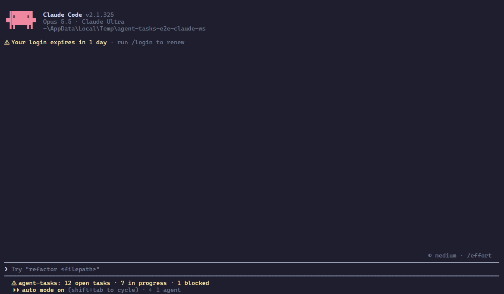

### Install

The pane comes with the agent-tasks plugin (Claude Code 2.1.289 or later), which also runs the MCP server:

```bash
claude plugin marketplace add keshrath/agent-tasks
claude plugin install agent-tasks@agent-tasks
```

Remove any hand-written `agent-tasks` entry from `~/.claude.json`, so the tools do not appear twice. Restart Claude Code; the status line under the prompt then shows what is in flight (`12 open tasks · 7 in progress · 1 blocked`).

### Open it

| You type           | It opens                                                              |
| ------------------ | --------------------------------------------------------------------- |
| `/pipeline`        | the board, the focus on its first task                                |
| `/pipeline 12`     | task 12 (`/pipeline #12` too), the focus on its next step             |
| `/pipeline <text>` | the board filtered to the tasks matching `<text>` (see [Find](#find)) |

The command also answers in the conversation with the board's summary, or with why there is no board.

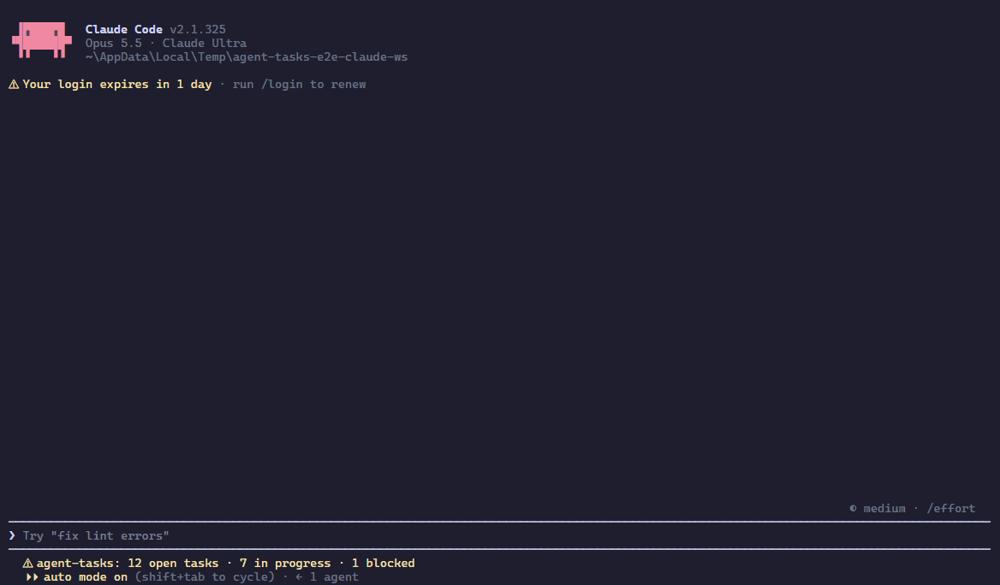

### Layouts

In the fullscreen layout (for example `CLAUDE_CODE_NO_FLICKER=1`) the pane docks beside the conversation and takes the mouse: a click presses a button. In a narrower terminal it docks narrower, and the text wraps instead of being cut.

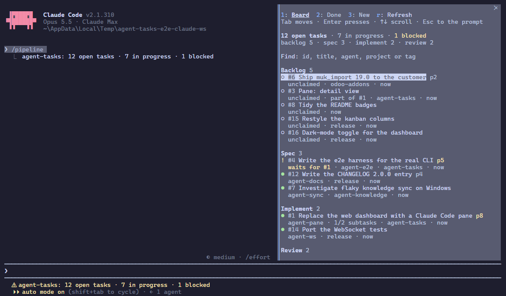

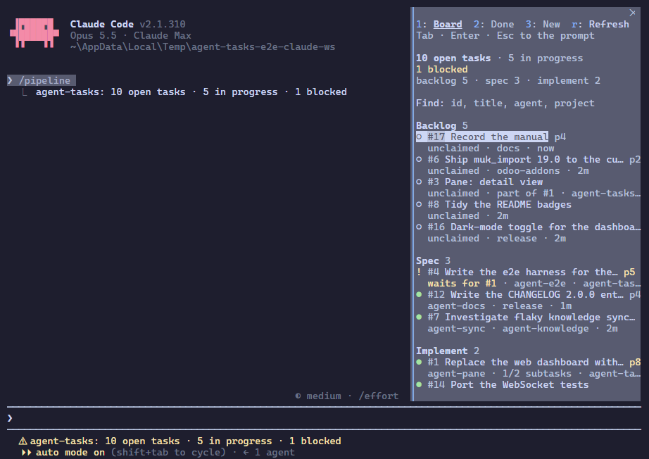

In the default layout the pane sits above the prompt, keyboard only.

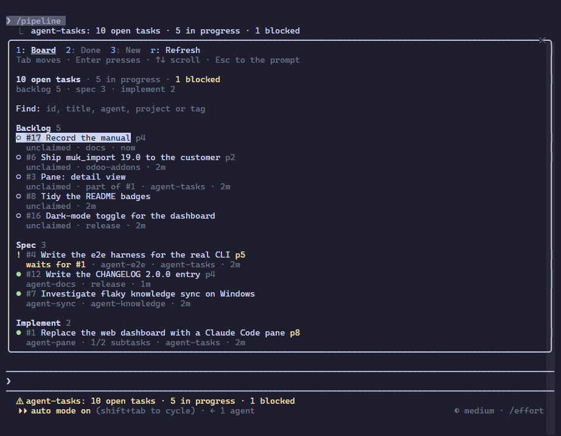

### The header and the keys

The first line holds the tabs and Refresh, the second says which keys work right now. That second line also carries the outcome of what you just did (`✓ #13 completed`, `✗ advance #7 failed: …`), which clears itself after a few seconds.

| Key                 | Does                                                          |
| ------------------- | ------------------------------------------------------------- |
| `1` `2` `3`         | Board, Done, New (pressed again: back to the tab's first row) |
| `Tab` / `shift+Tab` | move the focus ring to the next / previous control            |
| `Enter`             | press what has the focus; in a text field, submit it          |
| `↑` `↓`             | scroll the pane                                               |
| `r`                 | refresh now                                                   |
| `Esc`               | give the keyboard back to the prompt (the pane stays open)    |
| `ctrl+x tab`        | take the keyboard back, the focus where you left it           |

While a text field has the focus, digits and letters go into it. The header then drops the digits (`Board  Done  New  Refresh`) and says `Tab leaves the field · Esc to the prompt` (in the New form, where `Tab` goes on to the next field, `Tab next field · Esc to the prompt`). The pane never puts the focus in a text field by itself when `/pipeline` opens it or you move to a view, so what you type next is never caught by a field you did not pick; the New tab, which you open to type, is the one exception.

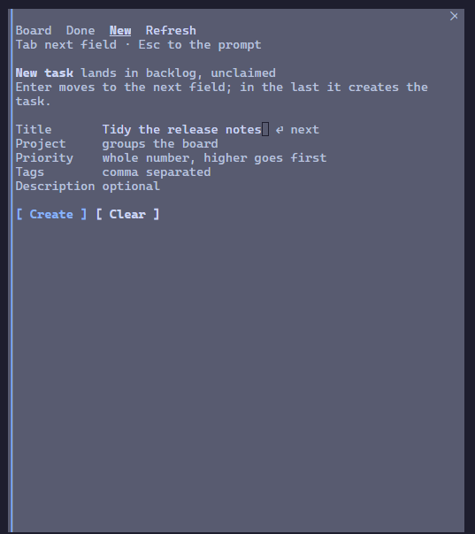

After `Esc` the header says how to come back:

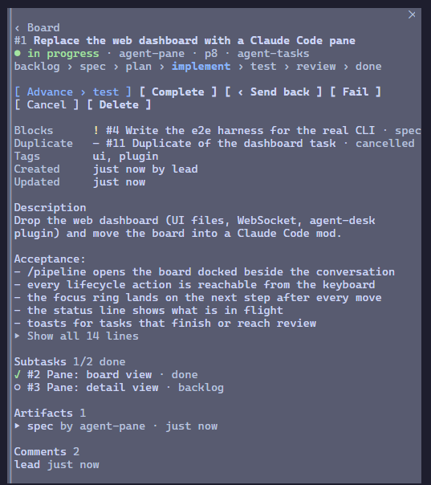

### Board

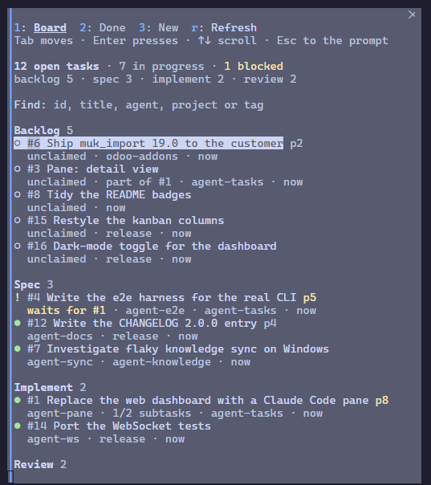

- **Summary**: `12 open tasks · 7 in progress · 1 blocked`, the same text as the status line entry, and under it the count per stage (`backlog 5 · spec 3 · …`).
- **Stages**: open tasks grouped by pipeline stage, in pipeline order; within a stage, working tasks first, then by priority. A long stage nobody works on yet (a backlog of more than 12) shows its first 10 and `▸ N more in backlog`, so the work in flight below stays in reach; `Enter` unfolds it and puts the focus on the first row it showed, with `▾ Fold backlog` right above it to fold it again. A find shows every match. Finished tasks are under [Done](#done).
- **Rows**: a mark, the id, the title and its priority (`p8`; high ones in yellow), then a dim line with the assignee (or `unclaimed`), the parent (`part of #1`), subtask progress (`1/2 subtasks`), the project and the age.

| Mark | Means                                                             |
| ---- | ----------------------------------------------------------------- |
| `●`  | in progress: an agent claimed it                                  |
| `○`  | pending: waits for an agent to claim it                           |
| `!`  | blocked: a `blocks` dependency is open (`waits for #1` in yellow) |

`Tab` walks the rows, `Enter` opens one.

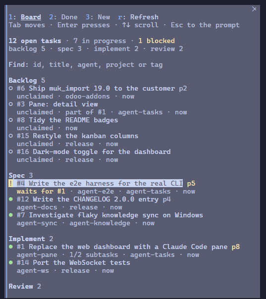

#### Find

Find narrows the board to the tasks whose id, title, assignee, project or tags contain the text. The summary then counts `4 shown`, and a row found by a tag shows that tag. `[ Clear the filter ]` shows everything again. `/pipeline <text>` opens the board already filtered.

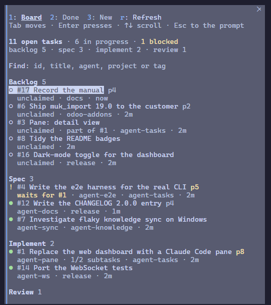

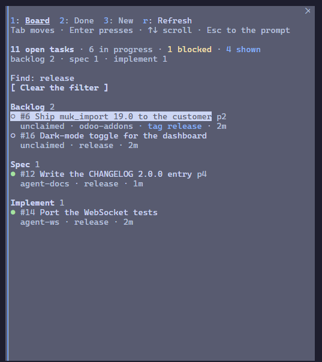

### Done

The `2` key lists recently finished tasks, newest first: `✓` completed, `✗` failed, `–` cancelled, with who finished it, where, and the result (or the error, or the reason) beneath, on one line so the list stays easy to scan: a long one is cut with `…`, and the task's detail has all of it. `Enter` opens one.

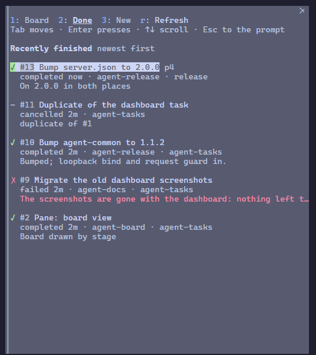

### New task

The `3` key opens a form with the focus in Title: Title, Project, Priority (a whole number, higher goes first), Tags (comma separated) and Description. `Enter` moves to the next field; `Enter` in Description, or `[ Create ]`, creates the task in the first stage, unclaimed, and opens it. `[ Clear ]` empties the form. A priority that is no whole number is said under its field, and the focus goes back there.

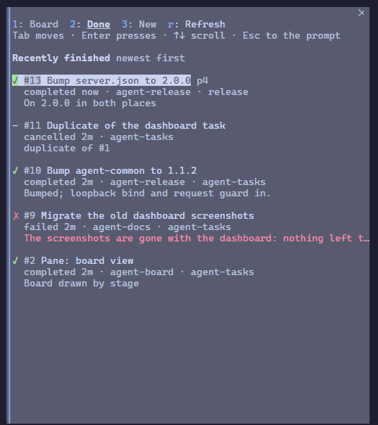

### A task

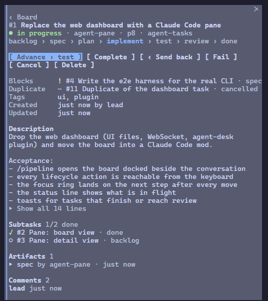

From the top:

- **`‹ Board`** goes back to where you came from (`‹ Done`, or `‹ #4` when you opened a linked task).
- **Title**, then a status line: the state (`● in progress`, `○ unclaimed`, `! blocked`, `✓ completed`, `✗ failed`, `– cancelled`), assignee, priority and project.
- **Stage strip**: the pipeline with the current stage highlighted (in red for a failed task).
- **Actions** for the task as it is now (see [Actions](#actions)).
- **Facts**: `Result`, `Error` or `Reason` once closed; `Waits for` (what blocks it), `Blocks` (what it blocks), `Related`, `Duplicate`, `Part of` (its parent), each with the linked task's mark, title and stage: `Enter` opens it. Then `Tags`, `Created … by …` and `Updated`.
- **Description**: one of 14 lines or more shows its first 8 (`▸ Show all N lines`).
- **Subtasks** with their progress (`1/2 done`); `Enter` opens one.
- **Artifacts** agents attached (specs, test results, review notes, rejections): `Enter` unfolds one as Markdown (cut at 4,000 characters) and folds it again.
- **Comments**: the last 5 (`▸ N earlier` shows the rest), and a field to add one. A comment is sent as you (`AGENT_TASKS_USER`, else your OS user name).

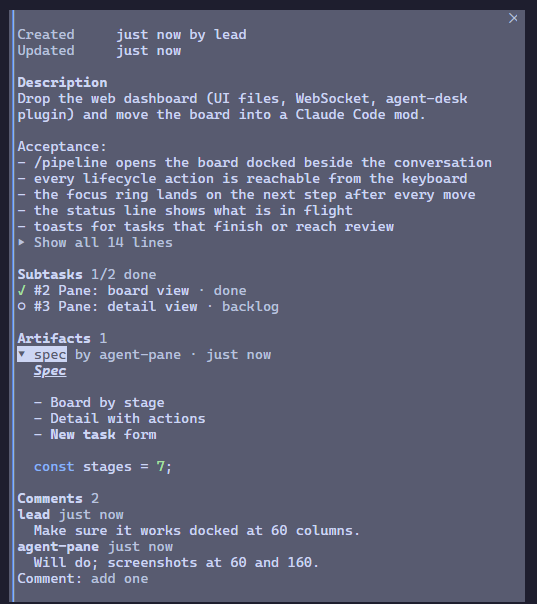

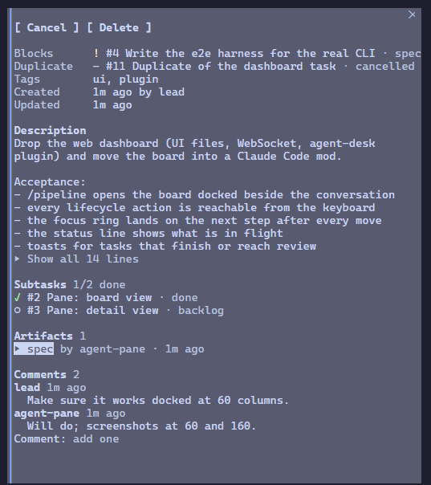

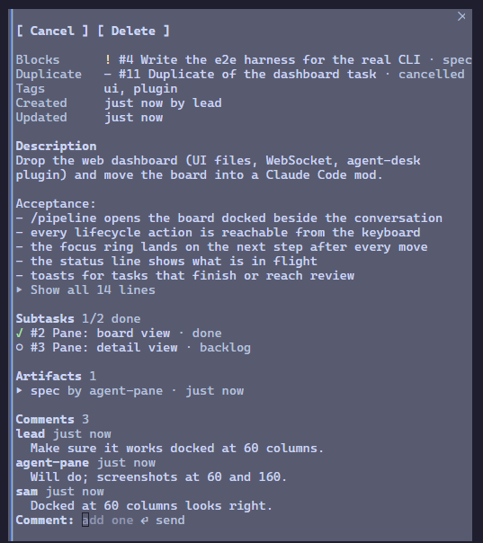

### Actions

What a task offers depends on where it is:

| The task is                    | Actions                                                                         |
| ------------------------------ | ------------------------------------------------------------------------------- |
| in progress                    | `Advance › <next stage>`, `Complete`, `‹ Send back`, `Fail`, `Cancel`, `Delete` |
| in progress, in its last stage | `Complete`, `‹ Send back`, `Fail`, `Cancel`, `Delete`                           |
| blocked                        | `‹ Send back`, `Fail`, `Cancel`, `Delete`: no Advance, no Complete              |
| unclaimed                      | `Cancel`, `Delete`                                                              |
| completed, failed or cancelled | `Delete`                                                                        |

There is no Claim: agents claim with `task_stage`. An unclaimed task says `Unclaimed: it moves on once an agent claims it.` (or `Waiting for <agent> to start it.` when one is assigned but has not started).

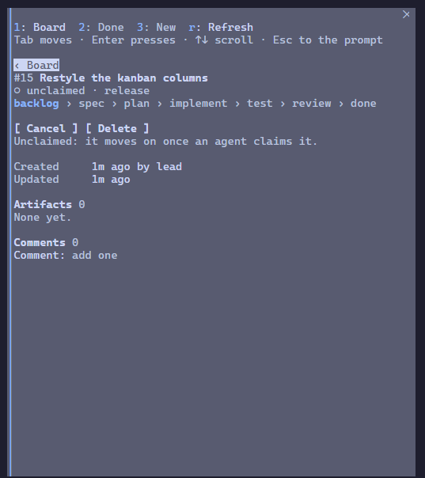

When a task opens, the focus is on its next step: Advance, or Complete in its last stage, or what a blocked task waits for. Every action you take is recorded as you (`by`).

#### Advance

`Advance › plan` moves the task to the next stage.

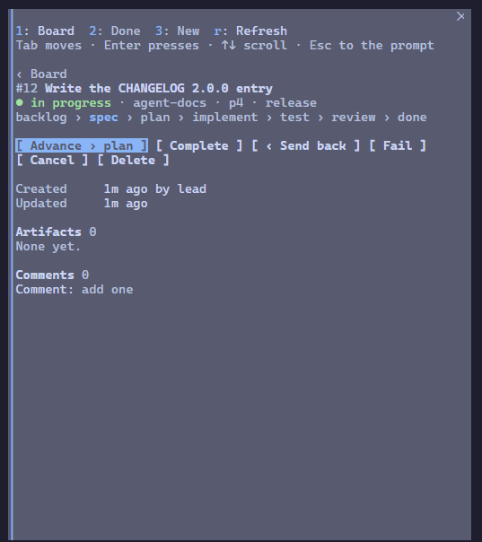

#### Send back

`‹ Send back` opens a small form: `Back to` picks the earlier stage, `Why` takes an optional note (kept as a `rejection` artifact). `Enter` in the field, or `[ Send back ]`, does it; `[ Never mind ]` closes the form. The focus then lands on `‹ Board`, not on Advance, so a second `Enter` does not undo it.

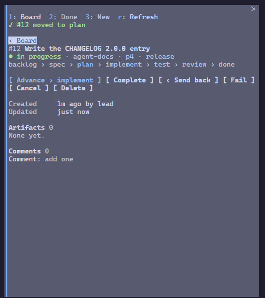

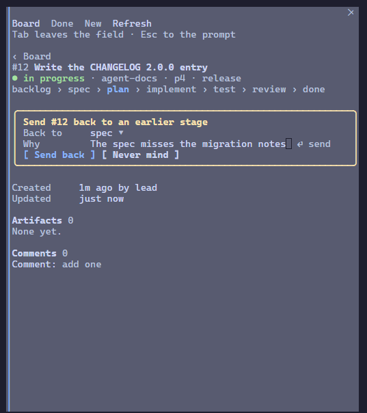

#### Complete, Fail, Cancel

Each asks for its words first: `Complete` the result, `Fail` what went wrong, `Cancel` why the task is dropped. `Enter` in the field, or the form's own button (`[ Complete ]`, `[ Fail ]`, `[ Cancel task ]`), does it.

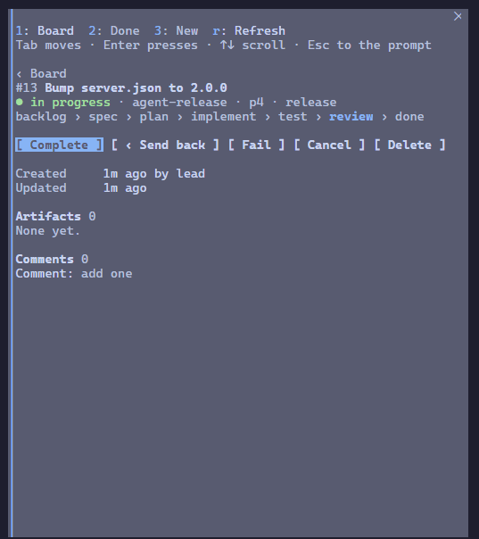

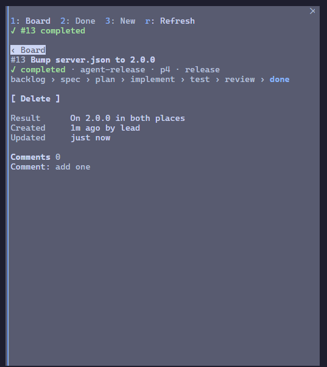

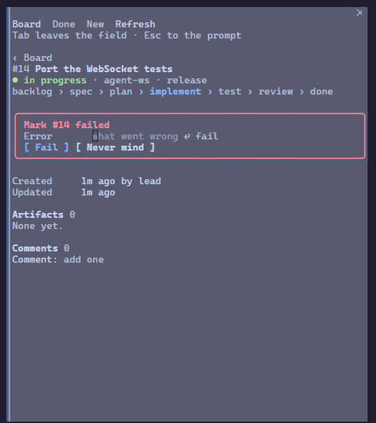

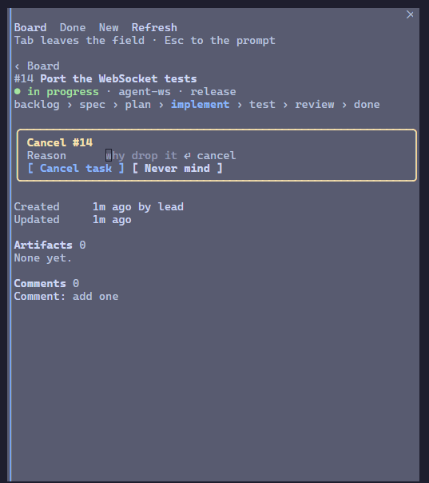

#### Delete

`Delete` asks first, in a red box, with the focus on `[ Never mind ]`. `shift+Tab` and `Enter` on `[ Delete ]` delete the task with its artifacts and comments; there is no undo.

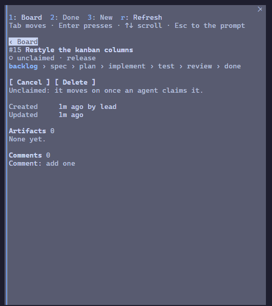

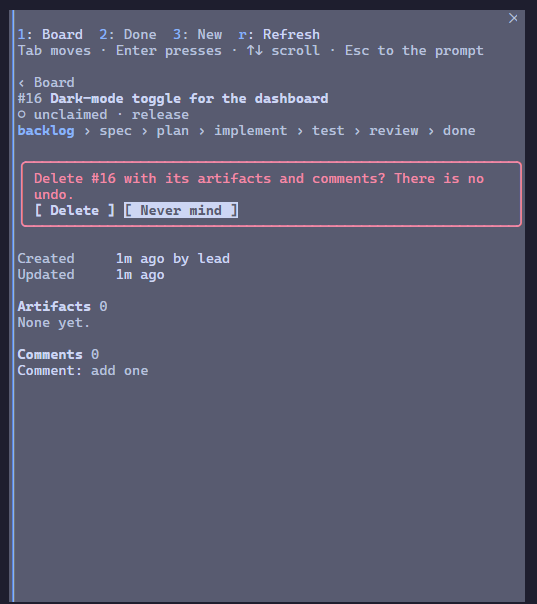

### Blocked tasks

A task with an open `blocks` dependency cannot move on: it offers no Advance and no Complete (the server refuses both), and says what it waits for, with the focus on that task. `Enter` opens the blocker; `‹ #4` comes back.

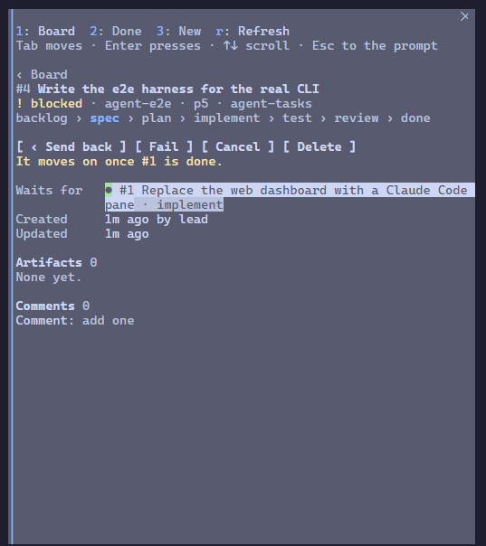


### Stage gates

A project's stage gate (`task_config` action `pipeline` with a `gate_config`) can ask for a comment or named artifacts before a task leaves a stage. The detail says what the gate still needs under the actions, and who gives it: `Needs a comment before it leaves spec: add the comment below.`, or `Needs artifact design before it leaves spec: an agent attaches artifacts.` While it holds, Advance and Complete are offered but not marked as the step to take. Pressed anyway, the action is refused (`✗ #7 can't leave spec yet`; the line under the actions says why); when the gate wants a comment, the focus then moves to the comment field. A refused Complete keeps its form open with what you typed, so after the comment its `Complete` button finishes the task. The gate holds for Advance and for Complete alike. Add what it asks for and the line goes.

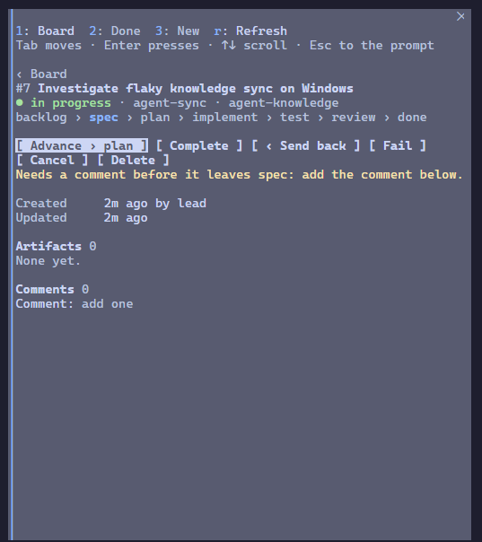

### Status line and toasts

The status line entry under the prompt is the board's summary and stays there while the pane is closed (it refreshes every 30 s then, every 5 s while the pane is open). When another session finishes a task or moves one to review, a toast says so, the news first: `Done: #5 Review the REST changes`, `Failed: #…`, `Ready for review: #…`. What you do in the pane itself makes no toast.

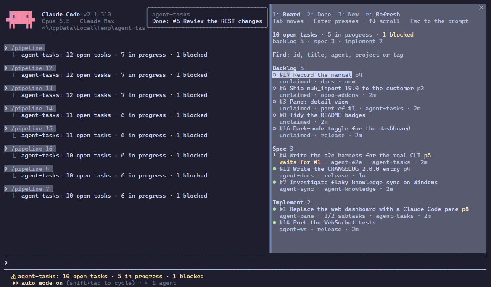

### What the model sees

The plugin adds one short context block (`prompt.context`) to what the model is given: what is in progress (up to 5 tasks), the top 3 pending tasks by priority, and that a task is claimed with `task_stage` before working on it, and that you follow the board in `/pipeline`. For example:

```
agent-tasks pipeline (shared by every session): 2 in progress: #1 "Replace the web dashboard with a Claude Code pane" [implement, agent-pane]; #4 "Write the e2e harness for the real CLI" [spec, agent-e2e]. 1 pending, highest priority first: #6 "Ship muk_import 19.0 to the customer" [backlog]. Claim a task (task_stage) before working on it. The person follows the board in /pipeline.
```

### When the server is away

The pane reads the REST API of the agent-tasks MCP server (`AGENT_TASKS_PORT`, default 3422). The first MCP process serves it; when that session ends, another one takes the port over within 5 s. If nothing answers, the pane says so instead of showing a stale board, the status line says `offline`, and the focus is on Refresh: `Enter` tries again (`✗ still no board (21:47:08)`) and brings the board back once a server answers. It also comes back by itself on the next poll, with the focus where it was before (or on the first task).

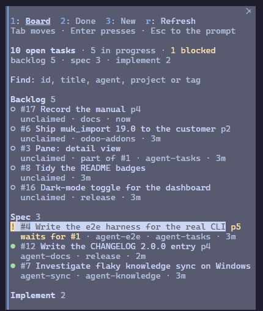

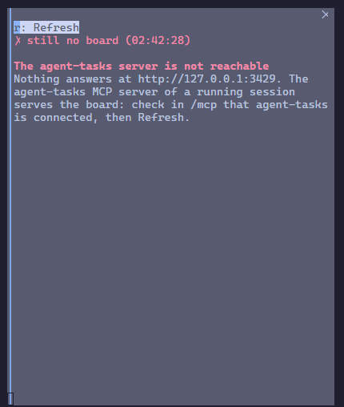

If an agent-tasks 1.x process still holds the port, the pane says `An older agent-tasks (1.x) holds the port`: end the sessions still running it.

### Troubleshooting the pane

| Symptom                                     | What to do                                                                                                             |
| ------------------------------------------- | ---------------------------------------------------------------------------------------------------------------------- |
| `/pipeline` is not a command                | Install the plugin (above), restart Claude Code; it needs Claude Code 2.1.289+.                                        |
| `The agent-tasks server is not reachable`   | Check in `/mcp` that agent-tasks is connected; `AGENT_TASKS_PORT` must be the same for the MCP server and Claude Code. |
| `An older agent-tasks (1.x) holds the port` | End the Claude Code sessions (or the process) still running 1.x; a 2.x process takes the port over.                    |
| `pane not shown: …` in the conversation     | Claude Code could not place the pane; the reason follows the message.                                                  |
| Keys type into a field                      | A text field has the focus (`Tab leaves the field`): `Tab` out of it first.                                            |
| Keys go to the prompt                       | The prompt has the keyboard: `ctrl+x tab` gives it to the pane.                                                        |
| A task has no Advance                       | It is unclaimed (an agent claims it with `task_stage`) or blocked (see `Waits for`).                                   |
| A claimed task turned failed by itself      | The cleanup hooks fail the tasks of agents that are gone (see [Stale Tasks](#stale-tasks)).                            |

### Recording these pictures

`npm run manual:record` (needs the `claude` CLI, logged in) builds, starts a scratch board on its own port and database, drives the real Claude Code CLI with the plugin from this checkout, and writes every picture of this chapter to `docs/images/manual/`: the stills as PNG, the flows as GIF, encoded in pure JS. The seed is the same each run. `npm run manual:record -- delete` writes only the pictures whose name contains `delete`.

---

## 5. MCP Tools Reference

agent-tasks exposes **8 action-based MCP tools**. Older releases had 14+ tools; the consolidation merged the per-action tools (`task_claim`, `task_advance`, `task_complete`, `task_fail`, `task_query`, `task_dependency`, `task_collaborator`, `task_approval`, `task_get_subtasks`, etc.) into the action-based tools below to keep prompt overhead minimal.

**Results and errors.** A tool result is the JSON of what the tool returns, as text, followed by a short pipeline reminder (`AGENT_TASKS_INSTRUCTIONS=0` drops it). A failure is a result with `isError: true` and the text `Error [CODE]: message`, where `CODE` is `NOT_FOUND` (no such task, comment or artifact), `CONFLICT` (the task's state does not allow it: closed, blocked by a dependency, already at its last stage), `VALIDATION_ERROR` (bad input, or a stage gate not met) or `UNKNOWN_ERROR` (anything unexpected).

### task_create

Create a pipeline task. Tasks start in `backlog` by default.

**Parameters:**

| Name          | Type     | Required | Description                                                            |
| ------------- | -------- | -------- | ---------------------------------------------------------------------- |
| `title`       | string   | Yes      | Task title (max 500 chars)                                             |
| `description` | string   | No       | Detailed instructions (max 50K chars)                                  |
| `assign_to`   | string   | No       | Agent name to assign to                                                |
| `stage`       | string   | No       | Initial pipeline stage (default: backlog)                              |
| `priority`    | number   | No       | Priority -- higher number = more important (default: 0)                |
| `project`     | string   | No       | Project name for grouping                                              |
| `tags`        | string[] | No       | Tags for categorization                                                |
| `parent_id`   | number   | No       | Parent task ID -- creates a subtask that inherits project and priority |

**Example:**

```
task_create with title "Implement auth module", project "backend", priority 10, tags ["security"]
task_create with title "Write unit tests", parent_id 42
```

---

### task_get

Get a single task by ID with full details. Always returns its artifacts, `comments_count`, `claim_status`, `gate_needs` (what the current stage's gate still asks for: `{ stage, comment, artifact, artifacts, min_artifacts, approval }`, null when nothing or the task is closed) and `dependencies`: `blockers` and `blocking` (the `blocks` links) and `links` (`related` / `duplicate`, each `{ task, relationship, direction }`). Optionally include subtasks, comments and the transitive dependency chain in one call.

**Parameters:**

| Name      | Type     | Required | Description                                                                                                      |
| --------- | -------- | -------- | ---------------------------------------------------------------------------------------------------------------- |
| `task_id` | number   | Yes      | Task ID to retrieve                                                                                              |
| `include` | string[] | No       | Any combination of `"subtasks"`, `"artifacts"`, `"comments"`, `"transitive_deps"`                                |
| `stage`   | string   | No       | Filter artifacts by stage (only when `include` contains `"artifacts"`)                                           |
| `limit`   | number   | No       | How many of the newest comments to return, oldest first (only when `include` contains `"comments"`, default 100) |

**Examples:**

```
task_get with task_id 42
task_get with task_id 42, include ["subtasks", "artifacts"]
task_get with task_id 42, include ["artifacts"], stage "implement"
task_get with task_id 42, include ["comments"], limit 50
```

> Replaces the former `task_get_subtasks`, `task_get_artifacts`, `task_get_comments`, and `task_query` tools.

---

### task_list

List, search, or pick tasks.

**Parameters:**

| Name           | Type     | Required | Description                                                                    |
| -------------- | -------- | -------- | ------------------------------------------------------------------------------ |
| `query`        | string   | No       | Full-text search across titles and descriptions (FTS5)                         |
| `next`         | boolean  | No       | Return the single best available task (highest priority, unassigned, deps met) |
| `agent`        | string   | No       | Agent name for affinity scoring (only with next: true)                         |
| `status`       | string   | No       | Filter: `pending`, `in_progress`, `completed`, `failed`, `cancelled`           |
| `assign_to`    | string   | No       | Filter by assigned agent name                                                  |
| `stage`        | string   | No       | Filter by pipeline stage                                                       |
| `project`      | string   | No       | Filter by project                                                              |
| `collaborator` | string   | No       | Filter tasks where agent is a collaborator                                     |
| `root_only`    | boolean  | No       | Only show top-level tasks (no subtasks)                                        |
| `parent_id`    | number   | No       | Filter subtasks of a specific parent                                           |
| `tags`         | string[] | No       | Filter by tags; a task must carry every tag listed                             |
| `limit`        | number   | No       | Max results (default: 500 for list, 50 for search)                             |
| `offset`       | number   | No       | Skip first N results (for pagination)                                          |

**Examples:**

```
task_list
task_list with project "backend", status "in_progress"
task_list with query "authentication"
task_list with next true, agent "my-agent"
```

---

### task_update

Update task metadata. Also handles dependency add/remove inline. Does not change stage or status (use `task_stage` for that).

**Parameters:**

| Name          | Type     | Required | Description                                                                                                                                                              |
| ------------- | -------- | -------- | ------------------------------------------------------------------------------------------------------------------------------------------------------------------------ |
| `task_id`     | number   | Yes      | Task ID                                                                                                                                                                  |
| `title`       | string   | No       | New title                                                                                                                                                                |
| `description` | string   | No       | New description                                                                                                                                                          |
| `priority`    | number   | No       | New priority                                                                                                                                                             |
| `project`     | string   | No       | New project                                                                                                                                                              |
| `tags`        | string[] | No       | New tags                                                                                                                                                                 |
| `assign_to`   | string   | No       | New assignee (empty string to unassign)                                                                                                                                  |
| `dependency`  | object   | No       | Add or remove a dependency inline: `{ action: "add"\|"remove", depends_on: <task_id>, relationship?: "blocks"\|"related"\|"duplicate" }` (relationship only used on add) |

**Examples:**

```
task_update with task_id 42, priority 20, tags ["urgent", "security"]
task_update with task_id 42, dependency { action: "add", depends_on: 41 }
task_update with task_id 42, dependency { action: "add", depends_on: 43, relationship: "related" }
task_update with task_id 42, dependency { action: "remove", depends_on: 41 }
```

> Dependency management is part of `task_update`; the former `task_dependency`, `task_add_dependency`, and `task_remove_dependency` tools are gone.

---

### task_delete

Delete a task and all its artifacts, comments, and dependencies (cascading). Cannot be undone.

**Parameters:**

| Name      | Type   | Required | Description       |
| --------- | ------ | -------- | ----------------- |
| `task_id` | number | Yes      | Task ID to delete |

---

### task_stage

Move a task through its lifecycle. All claim/assign/advance/regress/complete/fail/cancel transitions live here.

**Parameters:**

| Name      | Type   | Required | Description                                                                      |
| --------- | ------ | -------- | -------------------------------------------------------------------------------- |
| `action`  | string | Yes      | One of: `claim`, `assign`, `advance`, `regress`, `complete`, `fail`, `cancel`    |
| `task_id` | number | Yes      | Task ID                                                                          |
| `claimer` | string | No       | Agent name claiming (claim only, uses session name if omitted)                   |
| `stage`   | string | No       | Target stage (advance: optional, advances to next if omitted; regress: required) |
| `comment` | string | No       | Comment (advance: optional, satisfies stage-gate require_comment check)          |
| `reason`  | string | No       | Reason for regression or cancellation                                            |
| `result`  | string | No       | Result summary (complete) or error description (fail)                            |

**Examples:**

```
task_stage with action "claim", task_id 42
task_stage with action "advance", task_id 42
task_stage with action "advance", task_id 42, stage "implement", comment "Spec approved"
task_stage with action "regress", task_id 42, stage "plan", reason "Missing error handling"
task_stage with action "complete", task_id 42, result "Auth module implemented with JWT + refresh tokens"
task_stage with action "fail", task_id 42, result "CI pipeline broken, cannot test"
task_stage with action "cancel", task_id 42, reason "Requirements changed"
```

**Error cases:**

- An open `blocks` dependency refuses `advance` and `complete` (claim does not check it).
- Stage gate requirements (artifacts, comments) must be satisfied.
- Cannot advance past the last stage (use `complete` instead).

> Replaces the former `task_claim`, `task_advance`, `task_regress`, `task_complete`, `task_fail`, and `task_cancel` tools.

---

### task_artifact

Attach artifacts or comments to a task. Four types are supported.

**Parameters:**

| Name                | Type   | Required | Description                                                                       |
| ------------------- | ------ | -------- | --------------------------------------------------------------------------------- |
| `type`              | string | Yes      | One of: `general`, `decision`, `learning`, `comment`                              |
| `task_id`           | number | Yes      | Task ID                                                                           |
| `name`              | string | No       | Artifact name (type: general, e.g. "spec", "test-results", "review-notes")        |
| `content`           | string | No       | Artifact content (general: max 100K; learning: the insight; comment: the text)    |
| `stage`             | string | No       | Stage to attach to (type: general, defaults to current stage)                     |
| `chose`             | string | No       | What was chosen (type: decision)                                                  |
| `over`              | string | No       | Alternatives considered (type: decision)                                          |
| `because`           | string | No       | Rationale (type: decision)                                                        |
| `category`          | string | No       | Learning category: `technique`, `pitfall`, `decision`, `pattern` (type: learning) |
| `parent_comment_id` | number | No       | The comment this one replies to (type: comment)                                   |

**Examples:**

```
# General artifact
task_artifact with type "general", task_id 42, name "spec", content "## Auth Module Spec\n..."

# Decision record
task_artifact with type "decision", task_id 42, chose "JWT with refresh tokens", over "Session cookies, OAuth2 only", because "Stateless, works with mobile clients"

# Learning
task_artifact with type "learning", task_id 42, content "better-sqlite3 WAL mode needs explicit checkpoint for large transactions", category "pitfall"

# Comment, and a reply to comment 7
task_artifact with type "comment", task_id 42, content "Is the refresh token rotated?"
task_artifact with type "comment", task_id 42, content "Yes, on every use", parent_comment_id 7
```

**Behavior:**

- General artifacts auto-version -- re-attaching the same name at the same stage creates a new version.
- Learnings auto-propagate to parent and sibling tasks when the task is completed.

---

### task_config

Configuration and admin operations.

**Parameters:**

| Name              | Type     | Required | Description                                                          |
| ----------------- | -------- | -------- | -------------------------------------------------------------------- |
| `action`          | string   | Yes      | One of: `session`, `pipeline`, `cleanup`, `rules`                    |
| `project`         | string   | No       | Project name (pipeline: scope, rules: project-specific)              |
| `stages`          | string[] | No       | Stage names in order (pipeline set mode)                             |
| `gate_config`     | object   | No       | Stage-gate config (pipeline only, see below)                         |
| `id`              | string   | No       | Session ID (session only)                                            |
| `name`            | string   | No       | Session name (session only)                                          |
| `mode`            | string   | No       | Cleanup mode: `retention`, `stale_agents`, `all` (cleanup only)      |
| `timeout_minutes` | number   | No       | Heartbeat timeout for stale detection (cleanup only, default: 30)    |
| `format`          | string   | No       | Output format for rules: `mdc` (Cursor) or `claude_md` (Claude Code) |

**Action: session**

Set agent identity for the current MCP session. Call this first so the session name appears in task assignments and comments.

```
task_config with action "session", name "auth-developer"
```

**Action: pipeline**

Get or set pipeline stages and gate configuration for a project.

```
# Get current pipeline config
task_config with action "pipeline"
task_config with action "pipeline", project "backend"

# Set custom stages
task_config with action "pipeline", project "backend", stages ["backlog", "design", "build", "test", "deploy"]

# Set gate config
task_config with action "pipeline", project "backend", gate_config {"require_comment": true, "gates": {"test": {"require_artifacts": ["test-results"]}}}
```

**Gate config structure:**

| Field              | Type     | Description                                                     |
| ------------------ | -------- | --------------------------------------------------------------- |
| `require_comment`  | boolean  | Require at least one comment before advancing (default: false)  |
| `require_artifact` | boolean  | Require at least one artifact at current stage (default: false) |
| `exempt_stages`    | string[] | Stages exempt from gate checks (e.g. ["backlog"])               |
| `gates`            | object   | Per-stage rules (see below)                                     |

Per-stage gate rules:

| Field                   | Type     | Description                                                              |
| ----------------------- | -------- | ------------------------------------------------------------------------ |
| `require_artifacts`     | string[] | Named artifacts that must exist before advancing                         |
| `require_min_artifacts` | number   | Minimum artifact count required                                          |
| `require_comment`       | boolean  | Require at least one comment                                             |
| `require_approval`      | boolean  | Require an approved approval. No tool records approvals, so leave it off |

**Example: self-review gate**

Enforce that every task gets a review before completion — even when a single agent does all the work. Configure the review stage to require a `review-notes` artifact:

```
task_config({
  action: "pipeline",
  project: "my-project",
  gate_config: {
    gates: {
      "review": { "require_artifacts": ["review-notes"] }
    },
    exempt_stages: ["backlog"]
  }
})
```

Now advancing past the review stage fails unless a `review-notes` artifact exists:

```
task_artifact({ type: "general", task_id: 42, name: "review-notes",
  content: "Re-read diff, ran tests (all pass), verified acceptance criteria met." })
task_stage({ action: "advance", task_id: 42 })
```

This works for both solo and multi-agent workflows. Solo: the implementing agent self-reviews. Multi-agent: a different agent can claim the review stage and attach the artifact.

**Action: cleanup**

Purge old completed tasks or stale agent tasks.

```
task_config with action "cleanup"
task_config with action "cleanup", mode "stale_agents", timeout_minutes 60
task_config with action "cleanup", mode "all"
```

**Action: rules**

Generate IDE rule files for task pipeline usage.

```
task_config with action "rules", format "claude_md"
task_config with action "rules", format "mdc", project "backend"
```

---

> **Note on removed tools:** earlier releases had separate `task_dependency`, `task_collaborator`, and `task_approval` tools. The dependency tool was folded into `task_update` (see above). The `task_collaborator` and `task_approval` tools were removed entirely — the workflows they covered (multi-reviewer approvals, role-based collaboration) proved unused. If you need them back, they're recoverable from git history but consider whether the simpler stage-gate model in `task_config { action: "pipeline" }` is enough.

---

## 6. REST API Reference

All endpoints return JSON. Loopback only: a foreign `Host` header gets 403, so does any request carrying an `Origin` header (loopback origins included), request bodies must be `application/json`, no wildcard CORS.

Eight routes: what the `/pipeline` pane and the hook scripts call. Everything else goes through the MCP tools.

```
GET    /health                        Health check with version, uptime, task count
GET    /api/board                     Open tasks, recently closed ones (?recent=30), pipelines, dependencies, subtask progress
GET    /api/pipeline                  Pipeline stages and gate config (?project=)
GET    /api/tasks/:id                 One task as task_get (?include=subtasks,comments,transitive_deps; newest 100 comments)
POST   /api/tasks                     Create a task (body: {title, description?, priority?, project?, tags?, parent_id?, assign_to?, stage?, created_by?})
POST   /api/tasks/:id/stage           Lifecycle action (body: {action, stage?, comment?, reason?, result?, claimer?, by?})
POST   /api/tasks/:id/comments        Add comment (body: {content, agent_id?, parent_comment_id?})
DELETE /api/tasks/:id                 Delete a task
```

### Example Requests

```bash
# Health check
curl http://localhost:3422/health

# One task with its subtasks and comments
curl "http://localhost:3422/api/tasks/42?include=subtasks,comments"

# Create a task
curl -X POST http://localhost:3422/api/tasks \
  -H "Content-Type: application/json" \
  -d '{"title":"Fix login bug","project":"backend","priority":5}'

# Advance stage
curl -X POST http://localhost:3422/api/tasks/42/stage \
  -H "Content-Type: application/json" \
  -d '{"action":"advance","by":"me"}'
```

---

## 7. Pipeline Stages and Task Lifecycle

### Default Pipeline

The default pipeline has 7 stages:

```
backlog --> spec --> plan --> implement --> test --> review --> done
```

Tasks move forward through stages via `task_stage(action: "advance")` and can be regressed to earlier stages via `task_stage(action: "regress")`.

### Custom Pipelines

Each project can have its own pipeline stages:

```
task_config with action "pipeline", project "frontend", stages ["backlog", "design", "build", "qa", "deploy"]
```

### Task Status vs Stage

Tasks have both a **status** and a **stage**:

- **Status** tracks the overall lifecycle: `pending` (created), `in_progress` (claimed), `completed`, `failed`, `cancelled`.
- **Stage** tracks the pipeline position: `backlog`, `spec`, `plan`, `implement`, `test`, `review`, `done`.

Status transitions:

- `pending` -> `in_progress` (via `task_stage` action `claim`)
- `in_progress` -> `completed` (via `task_stage(action: "complete")`)
- `in_progress` -> `failed` (via `task_stage(action: "fail")`)
- Any non-terminal -> `cancelled` (via `task_stage(action: "cancel")`)

### Dependencies

Dependencies enforce ordering between tasks. A task with an open `blocks` dependency cannot be advanced or completed until the blocking task is closed (completed, failed or cancelled). Claiming does not check dependencies.

Relationship types:

| Type        | Behavior                                                                                         |
| ----------- | ------------------------------------------------------------------------------------------------ |
| `blocks`    | Blocks advance and complete until the dependency is closed; listed under `blockers` / `blocking` |
| `related`   | Informational link, does not block; listed under `links`                                         |
| `duplicate` | Marks tasks as duplicates, does not block; listed under `links`                                  |

One link per task pair: to turn a `related` link into `blocks`, remove it first.

Cycle detection prevents circular dependencies.

### Stage Gates

Stage gates enforce quality checks before advancement. Configure them per project:

```
task_config with action "pipeline", project "backend", gate_config {
  "require_comment": true,
  "exempt_stages": ["backlog"],
  "gates": {
    "test": {
      "require_artifacts": ["test-results"],
      "require_min_artifacts": 1
    }
  }
}
```

When a stage gate is not satisfied, `task_stage(action: "advance")` (and `complete`) returns an error naming the first unmet requirement; `task_get` lists them all in `gate_needs`.

### Agent Affinity

When using `task_list(next: true, agent: "my-agent")`, the system scores available tasks by affinity:

- Higher score for tasks where the agent worked on the parent task.
- Higher score for tasks where the agent worked on a dependency.
- Higher score for tasks in projects the agent has worked on before.

This is a tie-breaker when multiple tasks have the same priority.

### Learnings Propagation

Learnings attached via `task_artifact(type: "learning")` are automatically propagated to parent and sibling tasks when the task is completed. This allows insights discovered during implementation to flow upward and across the task tree.

---

## 8. Troubleshooting

### REST API Won't Start

**Symptom:** Port 3422 already in use by another program.

**Solutions:**

1. Set `AGENT_TASKS_PORT` to a free port in the MCP config env and in the environment Claude Code runs in (the `/pipeline` pane reads the same variable).
2. Find and stop the process using port 3422.
3. Multiple agent-tasks MCP instances share the same database. Only the first one serves the REST API; the others retry every 5 s and take over when it exits.

### Task Cannot Be Advanced

**Symptom:** `task_stage(action: "advance")` returns an error.

**Common causes:**

- **Unmet dependencies**: A blocking task is not yet completed. `task_get` always returns `dependencies` and `claim_status` (what blocks it); add `include: ["transitive_deps"]` for the whole chain. Remove a dependency with `task_update`'s `dependency` field.
- **Stage gate requirements**: Required artifacts or comments are missing. The error names the first unmet requirement; `task_get` lists them all in `gate_needs`. The gate holds for `complete` too.
- **Task closed**: a `completed`, `failed` or `cancelled` task cannot be advanced.

### Stale Tasks

**Symptom:** Tasks remain assigned to agents that are no longer running.

**Solutions:**

- If agent-comm is running, heartbeat-based cleanup automatically fails tasks from dead agents.
- Manual cleanup: `task_config(action: "cleanup", mode: "stale_agents", timeout_minutes: 30)`.
- Session hooks auto-fail orphaned tasks on session stop and clean up stale tasks on session start.

### Database Issues

**Symptom:** SQLite errors.

**Solutions:**

- The database is at `~/.agent-tasks/agent-tasks.db` by default (configurable via `AGENT_TASKS_DB`).
- If corrupted, delete the database and WAL files. All task data will be lost.
- The database uses WAL mode with schema versioning (currently V5). Migrations run automatically on startup.

---

## 9. FAQ

### Can I use this with Cursor/OpenCode?

Yes. agent-tasks is a standard MCP server. Any MCP-compatible client can use it.

### How does it integrate with agent-comm?

agent-tasks optionally connects to agent-comm via `AGENT_COMM_URL`. This enables:

- **Heartbeat-based cleanup**: Detects when agents die and auto-fails their tasks.
- **Bridge notifications**: Notifies connected agents on task events.

Without agent-comm, these features are gracefully skipped.

### What is the TodoWrite bridge?

When configured via hooks, agent-tasks intercepts Claude Code's built-in `TodoWrite` tool calls and syncs them to the pipeline. Todos become tasks on the `/pipeline` board.

### Can multiple agents work on the same task?

Not formally — the dedicated `task_collaborator` tool was removed in the consolidation. Today you have two options:

- **Sequential handoff**: agent A does its piece, calls `task_stage` to advance, agent B claims it (`task_stage` action `claim` with a different `claimer` name).
- **Parent + subtasks**: split the task into N subtasks via `task_create` with `parent_id`, and assign each subtask to a different agent. The pipeline view shows the parent and its children together.

If you genuinely need multi-agent collaborator semantics, the schema still has `task_collaborators`; it just isn't exposed via MCP. File an issue if you want it back.

### How do I reset the pipeline?

Delete and recreate the pipeline stages for a project:

```
task_config with action "pipeline", project "my-project", stages ["backlog", "spec", "plan", "implement", "test", "review", "done"]
```

### What happens to subtasks when a parent is completed?

Subtasks have independent lifecycles. Completing a parent does not auto-complete subtasks. The `/pipeline` board shows `done/total subtasks` on the parent's row, and its detail lists each subtask.

### How do I find the next available task?

```
task_list with next true
```

This returns the single highest-priority unassigned task with all dependencies met. Add `agent: "my-name"` for affinity-based routing.

### Where is the database stored?

Default: `~/.agent-tasks/agent-tasks.db`. Override with `AGENT_TASKS_DB` environment variable. The database uses WAL mode and FK constraints with cascading deletes.
